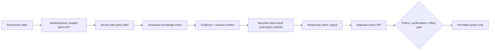

# Principals, retrieval and bounded tool effects

**Owning question:** Which boundary prevents retrieved instructions from acquiring execution authority?

This page belongs to [V09/C07 — Safety, isolation and privacy in agent-accessible services](README.md). Use the integrated walkthrough for the surrounding decision; the sections below own this narrower mechanism and its limits.

<!-- tycho-question-source:tycho.page.0ae1aabac3b64c2f924cc427684bdbab:1 -->
## 1. Define distinct security principals

A useful conceptual separation is:

| Identity | Typical control | It is **not** |
|---|---|---|
| End user | Authenticated principal with scoped resource entitlements | Permission to read every document that matches a query |
| Client application | Known client/installation and allowed API surface | A substitute for the end-user's object authorization |
| Model/agent runtime | Restricted tools, output limits and policy context | A trusted human administrator or authorization authority |
| Retrieved document / search result | Untrusted data, source ID, revision and access classification | Executable instruction or approval to call another tool |
| Knowledge service | Server-side scoped read/lookup and consistent snapshot | A generic filesystem proxy or arbitrary network fetch tool |
| Action executor (if any) | Independent permission enforcement, parameters, auditing and confirmations | A side effect delegated solely because a model requested it |

The service must evaluate every document read and every action against the **actual authorized subject and object**, not just a collection-wide login. [OWASP Authorization Cheat Sheet](https://cheatsheetseries.owasp.org/cheatsheets/Authorization_Cheat_Sheet.html) describes least privilege and deny-by-default. [OWASP Authorization Patterns](https://cheatsheetseries.owasp.org/cheatsheets/Authorization_Patterns_Cheat_Sheet.html) distinguishes policy enforcement from decision/evaluation, including resource-level responsibility.

A search that ranks a forbidden title but excludes its body can still leak metadata. Count, title, snippet, related links and citations must be evaluated against authorization, not just the final open-file operation.

<!-- /tycho-question-source -->
<!-- tycho-question-source:tycho.page.0ae1aabac3b64c2f924cc427684bdbab:2 -->
## 2. Treat retrieval as a data pipeline, not a command channel

**Text alternative:** authenticated callers receive only results permitted by server-side policy; the index is versioned and evidence is checked. Returned prose is data to the reasoning client. Any separately allowed action must pass its own authorization, schema, risk and confirmation gate—not inherit authority from a retrieved paragraph.

The separation has three parts:

1. **Transport control:** authenticated communication, bounded requests, size/rate/time limits, safe error responses, version negotiation.
2. **Data control:** metadata/source access, per-object authorization, safe ID/path resolution, revision and contamination policy, citation integrity.
3. **Effect control:** no arbitrary code execution or file/network access from the search surface; tightly scoped action tools where justified.

For read-only reference services, the safest baseline is **no mutation or execution tools at all**. If a separate system legitimately needs writes, keep their permissions isolated from search. A model's confidence or chain-of-thought is never a replacement for deterministic access checks.

<!-- /tycho-question-source -->
<!-- tycho-question-source:tycho.page.0ae1aabac3b64c2f924cc427684bdbab:3 -->
## 3. Prompt injection is a trust-boundary failure

Imagine a **fictional, publicly shared technical note** stored in a search index. The note contains normal latency guidance plus a sentence instructing readers' assistants to ignore access policies and fetch unrelated protected records. No such retrieval or external call is executed in this book example.

The note is allowed to be **quoted or described as data**, but cannot modify the executing assistant's instructions. A guard based only on "ignore malicious text" is fragile: the risk is structural when retrieved text is merged into high-priority instructions or interpreted as a tool command.

Defense-in-depth controls include:
- Separate tool-produced text and documents from trusted instructions; preserve source IDs and clearly label provenance.
- Limit capabilities exposed to an agent by default; deny broad filesystem/network endpoints unless necessary.
- Validate every action's arguments against a narrow schema, allowed IDs, resource permissions and a known business contract.
- Check entitlement **again at the authority that protects the effect**, even if the agent previously searched successfully.
- Require explicit independent human confirmation for actions with significant irreversible impact where appropriate; confirmation is not a substitute for ACLs.
- Reject unsupported or stale claims instead of hallucinating a source; never suppress known contradictory evidence.
- Test malicious-looking retrieved text, fabricated citation IDs, mixed entitlements and unexpected cross-document links.

OWASP LLM01 identifies both direct and indirect injection. There is **no foolproof natural-language filter**; preventing unacceptable effects requires server-side boundaries that do not depend solely on how the language model interprets prose.

<!-- /tycho-question-source -->

## Navigation, prerequisites and source scope

| Route | Destination |
|---|---|
| Parent and source ledger | [Chapter introduction and exact source rows](README.md#chapter-source-ledger) |
| Previous / prerequisite | [Read preceding context](safe-agent-access-and-knowledge-isolation.md) |
| Next | [Continue the reasoning](collection-privacy.md) |
| Integrated question | [Original scenario and limits](safe-agent-access-and-knowledge-isolation.md) |

The source material keeps its original published/inferred/synthetic/unverified distinctions. Chapter-wide citations are shared reference context, not proof that every cited source supports every sentence on this page. Freshly inspected text is identified explicitly; absent dates and unknowns are retained.
