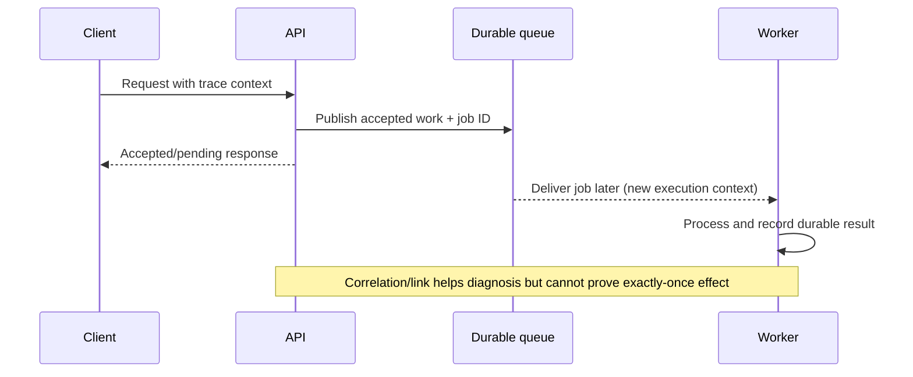

# Trace identity and causal interpretation

**Owning question:** What execution relationship can a span and its timing establish?

This page belongs to [V09/C03 — Distributed tracing and propagation](README.md). Use the integrated walkthrough for the surrounding decision; the sections below own this narrower mechanism and its limits.

<!-- tycho-question-source:tycho.page.f921597aae854c6996459fc025a9bca3:1 -->
## 1. A trace, a span and a request are different entities

| Identity | What it describes | What it does not prove |
|---|---|---|
| Trace ID | Correlates selected spans for one distributed trace | All effects, users or messages were recorded |
| Span ID and parent | A named timed operation and immediate relationship | Child timing is entirely CPU execution |
| Span link | Relationship to another span or asynchronous context | Guaranteed causal consistency or exactly-once delivery |
| Request/operation ID | Stable logical business intent where application defines one | Equivalent to a trace ID across all retries |
| Data/event identity | Durable domain effect with revision/sequence when required | A traced request committed successfully |

The [W3C Trace Context recommendation](https://www.w3.org/TR/trace-context/) standardizes HTTP propagation through traceparent and tracestate. It does not require every receiving service to create an exported span or guarantee a centralized complete trace. Trace context may be continued, ignored or regenerated at trust boundaries according to documented behavior.

<!-- /tycho-question-source -->
<!-- tycho-question-source:tycho.page.f921597aae854c6996459fc025a9bca3:2 -->
## 2. Causal and temporal interpretation

A parent/child span structure records instrumented containment or relationships. This is not a global wall-clock ordering guarantee: clocks can differ across hosts, and asynchronous work may start after an HTTP response. A parent duration need not equal the sum of child durations because children overlap or traces omit work.

**Text alternative:** API accepts a durable job then responds before background processing finishes. A later worker may create a distinct trace linked to the initiating operation. The job's authoritative status remains a separate domain record. No real runtime or messaging product was used.

Trace data can help locate where a delay happened only when:
- clocks/timestamps and parent relationships are interpreted at the correct boundaries;
- instrumentation covers the suspected operation;
- spans include meaningful errors, retries, concurrency and dependency context;
- one logical business operation may have several network attempts/traces;
- sampling and export failures are disclosed.

<!-- /tycho-question-source -->

## Navigation, prerequisites and source scope

| Route | Destination |
|---|---|
| Parent and source ledger | [Chapter introduction and exact source rows](README.md#chapter-source-ledger) |
| Previous / prerequisite | [Read preceding context](distributed-tracing-context-and-sampling.md) |
| Next | [Continue the reasoning](sampling-trust.md) |
| Integrated question | [Original scenario and limits](distributed-tracing-context-and-sampling.md) |

The source material keeps its original published/inferred/synthetic/unverified distinctions. Chapter-wide citations are shared reference context, not proof that every cited source supports every sentence on this page. Freshly inspected text is identified explicitly; absent dates and unknowns are retained.
