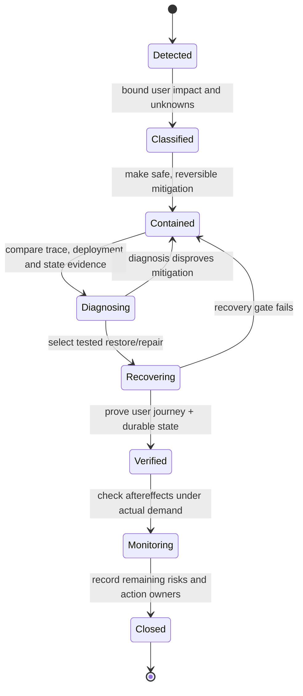

# Impact, response authority and bounded actions

**Owning question:** Which user outcome and response role govern incident decisions?

This page belongs to [V09/C06 — Incident response and operational change](README.md). Use the integrated walkthrough for the surrounding decision; the sections below own this narrower mechanism and its limits.

<!-- tycho-question-source:tycho.page.d87f9ba3852b49ee8188d150bb679716:1 -->
## 1. Define impact and correctness before the response procedure

An alert is evidence that a condition crossed a configured threshold. It is not automatically proof of a certain root cause or the precise population harmed. Record:

| Question | Evidence boundary |
|---|---|
| What user journey is affected? | Success, partial result, incorrect result or inability to access a required capability |
| Since when? | First observed symptoms, earliest known data change, detection/notification time and uncertainty |
| How extensive? | Affected operation/client/region/version, data sample and explicit unknowns |
| What invariant could be violated? | Duplicate committed effects, missing authoritative writes, unauthorized reads, stale output |
| What remains safe? | Known correct read-only mode, admission controls, unaffected partitions |
| Can the system recover? | Actual restore point, data reconciliation, replay/rollback contract and acceptance proof |
| Who may authorize a risky action? | Named role and applicable change/access policy, not assumed broad privileges |

A metric may improve after dropping all costly requests; business success has not necessarily improved. Similarly, a process may restart while an interrupted cross-system update remains unreconciled. Incident closure must therefore check user-visible correctness and durable recovery independently of availability.

<!-- /tycho-question-source -->
<!-- tycho-question-source:tycho.page.d87f9ba3852b49ee8188d150bb679716:2 -->
## 2. Functional roles and a single source of operational truth

Use a scalable incident role model, adapted to team size:

- **Incident coordinator:** owns shared situation awareness, priorities, delegation, decision log and next checkpoint; does not have to execute every change.
- **Operations lead:** owns approved intervention, health verification and rollback/forward recovery steps; reduces the danger of multiple responders changing the same system independently.
- **Communications lead:** states impact, what is known/unknown and updates affected parties at an appropriate cadence; does not invent ETAs or root causes.
- **Investigation lead(s):** gather read-only evidence, form competing hypotheses and run bounded diagnostic tasks with clear ownership.
- **Follow-up owner:** records unresolved evidence, temporary mitigations and post-incident corrective actions after stabilization.

These are responsibilities rather than a mandatory staffing template. One trained person may hold multiple roles in a small event; larger events should separate them. The [Google SRE incident guidance](https://sre.google/resources/practices-and-processes/incident-management-guide/) emphasizes coordination, communication and control independent of normal reporting lines.

### Original operational flow

Text alternative: incident detection leads to classification, containment and diagnosis. Recovery is an explicit step distinct from changing software; it needs a verification gate for customer-visible results and state correctness. If diagnosis or recovery fails, restore safe containment rather than assuming that mitigation succeeded.

<!-- /tycho-question-source -->
<!-- tycho-question-source:tycho.page.d87f9ba3852b49ee8188d150bb679716:3 -->
## 3. Response actions are architecture choices

| Mitigation | Can protect | Can damage if applied blindly |
|---|---|---|
| Stop unsafe writers | Prevent new incorrect durable effects | Block legitimate essential work; unprocessed commands may need replay |
| Reduce admitted work | Bound overload/retry amplification | Explicit rejection semantics and client backoff become necessary |
| Isolate faulty dependency | Preserve unaffected journeys | Partial responses must not imply complete authoritative truth |
| Roll back deployable version | Undo a code/config regression if state compatible | Persisted schema/events may not be readable by old code |
| Fail over a region/instance | Recover from named failure domain | Data lag, split-brain writes, fencing and stale routing |
| Restore from backup | Recover missing data when valid restore exists | May lose newer accepted operations; reconciliation required |
| Reconcile/replay durable events | Repair known missing projections/effects | Duplicate side effects without idempotency |
| Rotate compromised credential | End credential reuse | Can disable critical downstream service if dependencies unknown |

Read [safe rollout and recovery](../../../delivery/safe-rollout-and-recovery.md), [multi-region disaster recovery](../../../deployment/multi-region-disaster-recovery-contracts.md) and [idempotency](../../../distributed/transactional-outbox-and-idempotency.md) for the technical implementation models. An "undo" control that reverses only application code is not a safe data rollback.

<!-- /tycho-question-source -->

## Navigation, prerequisites and source scope

| Route | Destination |
|---|---|
| Parent and source ledger | [Chapter introduction and exact source rows](README.md#chapter-source-ledger) |
| Previous / prerequisite | [Read preceding context](incident-response-and-operational-change.md) |
| Next | [Continue the reasoning](incident-evidence.md) |
| Integrated question | [Original scenario and limits](incident-response-and-operational-change.md) |

The source material keeps its original published/inferred/synthetic/unverified distinctions. Chapter-wide citations are shared reference context, not proof that every cited source supports every sentence on this page. Freshly inspected text is identified explicitly; absent dates and unknowns are retained.
