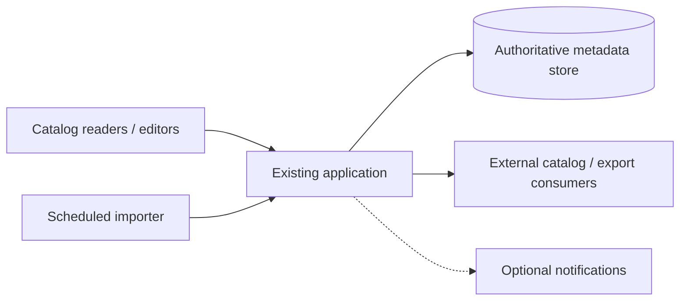

# Observed legacy behavior and baseline ownership

**Owning question:** Which existing behavior must be measured and preserved before change is justified?

This page belongs to [V10/C02 — Baseline analysis for existing software](README.md). Use the integrated walkthrough for the surrounding decision; the sections below own this narrower mechanism and its limits.

<!-- tycho-question-source:tycho.page.b2d1285c1c1a4a698a2306c4e766a4f1:1 -->
## 1. Old software is not itself an architecture defect

Age alone does not explain a service-level failure. The real drivers may be unsupported dependencies, high change lead time, untestable side effects, incompatible external protocols, data retention risk or an observed resource bottleneck. Equally, a long-lived modular system may be more reliable and cheaper to maintain than a newly distributed one.

Define the modernization outcome independently of the technology:

- Reduce the time to safely change a specific user journey while preserving existing behavior.
- Remove a documented unsupported runtime/dependency without invalidating its persisted data or external contracts.
- Reduce measured failure blast radius or recovery time at a named workload.
- Allow a distinct capability to deploy independently **only if** team/domain and transaction ownership genuinely support it.

An unknown issue should generate an investigation, not a design imperative. "Legacy monolith" is not a sufficient explanation for a slow request, deployment outage, audit deficiency or rising maintenance cost.

<!-- /tycho-question-source -->
<!-- tycho-question-source:tycho.page.b2d1285c1c1a4a698a2306c4e766a4f1:2 -->
## 2. Collect a baseline as an evidence-bearing architecture model

A useful baseline is **not** merely a box diagram. Record several boundaries independently:

| Dimension | Minimum question | Evidence that can answer it | Common false inference |
|---|---|---|---|
| User journeys | Which behavior is essential, optional, scheduled, degraded? | Client contract, test, support/usage statement with scope | Features documented are the ones still used |
| Module dependencies | Which code units depend on which internal contracts? | Versioned source, build metadata, call graph or test fixture | Package split equals deployable isolation |
| Runtime | Which process, task runner, JVM/container or service executes the work? | Deployment manifest, process config, observable topology | Repository layout equals deployment topology |
| State authority | Who can write, commit, delete and reconcile each critical entity? | Schema, migrations, writer inventory, transaction source | One table belongs to only one service |
| API/events | Who consumes historical versions, events, exports and callbacks? | Versioned API/event schemas and consumer evidence | All clients can be updated simultaneously |
| Failures and recovery | Which component must restart/restore, what gets replayed? | Runbook, observed drill, exception path, backfill protocol | Image rollback restores changed persisted state |
| Security and audit | Which authorization decision protects the actual business effect? | Policy enforcement path, log structure, tests | A gateway guarantees object-level isolation |
| Operational cost | Which team and resources maintain, upgrade and debug it? | Workload, incident and staffing evidence with date | More services automatically improve changeability |

A source snapshot proves what a specific revision says; it is not proof that the same version serves real traffic. Configuration and migration scripts may disagree with actual state. Leave that contradiction visible and request an explicit observation or reconciliation.

A baseline ideally records **what has never been verified**. Incomplete, visibly uncertain knowledge is safer than a polished fictional truth model.

<!-- /tycho-question-source -->
<!-- tycho-question-source:tycho.page.b2d1285c1c1a4a698a2306c4e766a4f1:3 -->
## 3. Original synthetic case: a catalog and import service

Imagine a community-run *public image catalog* that maintains licensed photo metadata, searchable titles, contributor permissions and periodic bulk imports. We invent these constraints solely for teaching:

- One deployed application serves interactive search, metadata edits and background batch import.
- A relational database is the only authoritative metadata writer.
- A scheduled import reads a file, upserts metadata, and may emit a notification after commit.
- Older clients read the public catalog; export consumers may rely on stable identifiers and timestamps.
- An operator says "nightly imports are taking longer" and "deployments are risky", but exact load, code ownership, failure records and version history are **not available**.

We deliberately do **not** assert a particular language/framework, actual downtime, numerical throughput or existing authorization bug. The two complaints are observations reported by a hypothetical stakeholder; their causes are unknown.

Text alternative: reads, edits and import pass through one deployed application, which owns the authoritative metadata. External consumers may depend on versioned IDs and schemas. Optional notifications introduce separate failure possibilities. The diagram is a candidate **baseline**, not a validated production inventory.

### Hypothesis register: investigate before rebuilding

| Observation | Competing explanation A | Competing explanation B | Minimal discriminator |
|---|---|---|---|
| Import is slower | Data volume/access path changed | External fetch or retry wait increased | Elapsed stages, query plans and external call timing |
| Deployment appears risky | No mixed-version schema compatibility | Slow maintenance window and absent rollback proof | Read migration and release history, test old/new clients |
| Search is sometimes stale | Index freshness or delayed projection | Browser/client cache | Compare authoritative row version and served response |
| Editor reports duplicate notifications | Retry of external side effect | Duplicate data-change event | Trace durable operation identity and consumer effect record |

Each hypothesis must remain a hypothesis until an admissible source or reproducible experiment discriminates it. Guessing a need for Kafka, event sourcing, distributed caching or microservices would add new failure boundaries before the existing one is understood.

<!-- /tycho-question-source -->

## Navigation, prerequisites and source scope

| Route | Destination |
|---|---|
| Parent and source ledger | [Chapter introduction and exact source rows](README.md#chapter-source-ledger) |
| Previous / prerequisite | [Read preceding context](legacy-baseline-and-modernization-evidence.md) |
| Next | [Continue the reasoning](modernization-options.md) |
| Integrated question | [Original scenario and limits](legacy-baseline-and-modernization-evidence.md) |

The source material keeps its original published/inferred/synthetic/unverified distinctions. Chapter-wide citations are shared reference context, not proof that every cited source supports every sentence on this page. Freshly inspected text is identified explicitly; absent dates and unknowns are retained.
