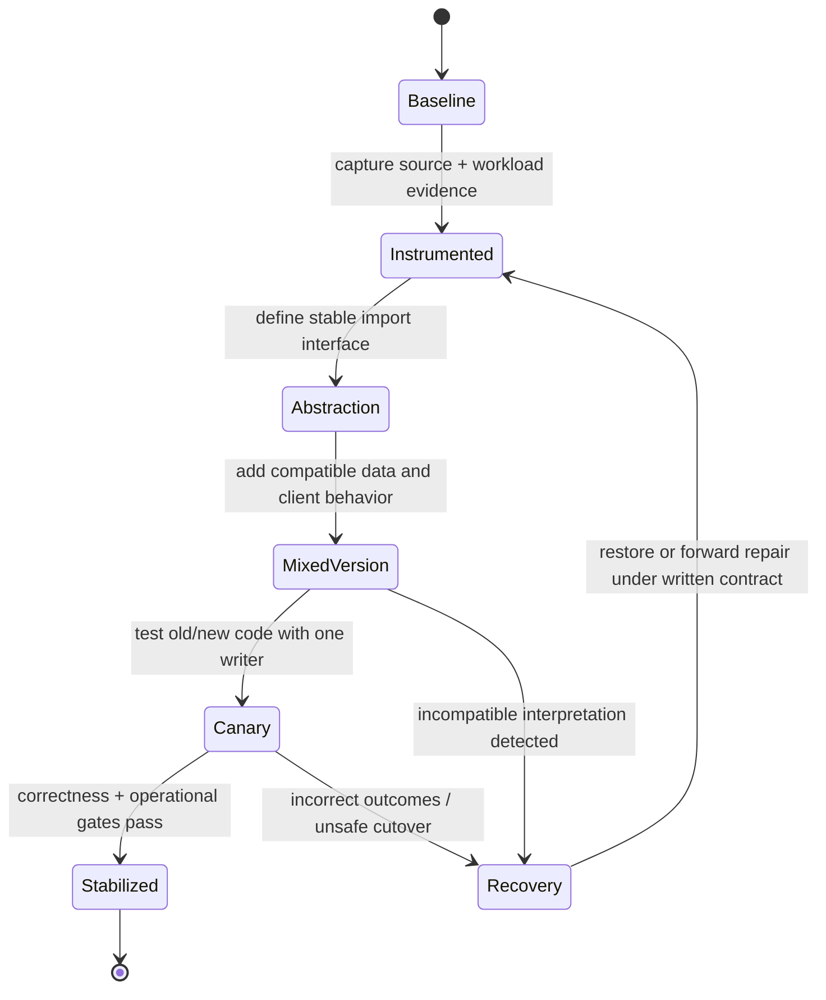

# Modernization alternatives and transition obligations

**Owning question:** How do retained, replaced and incrementally migrated options differ in required proof?

This page belongs to [V10/C02 — Baseline analysis for existing software](README.md). Use the integrated walkthrough for the surrounding decision; the sections below own this narrower mechanism and its limits.

<!-- tycho-question-source:tycho.page.b2d1285c1c1a4a698a2306c4e766a4f1:4 -->
## 4. Four modernization alternatives and contraindications

| Alternative | When it fits | Technical cost/risk | What would falsify it |
|---|---|---|---|
| A — retain and stabilize | Incidents trace to identifiable config/query/test gaps; current deployable ownership is adequate | Still needs observability, dependency security upgrades and recovery drills | Verified structural constraint prevents required improvement |
| B — upgrade runtime in place | Main driver is lifecycle/security support; APIs and state need not move | Runtime/library compatibility; old data encoding; mixed-version release | Cannot run required dependency/runtime combination or preserve externally required behavior |
| C — modularize behind internal contracts | Change coupling is dominant but separate deployment provides little benefit | Internal dependency reversal and contract-test investment | Actual transactions/coupling cannot be separated incrementally |
| D — bounded extraction with anti-corruption interface | Clear capability/state owner, independent release requirement and measured benefit | Distributed failure, data movement, observability, temporary dual-format complexity | No distinct ownership, unknown writer inventory, incompatible consumers or unacceptable cutover risk |

A replacement service does not become authoritative merely because its new database exists. If two writers can independently accept edits during transition without a conflict-resolution rule, state divergence is a risk. A "dual write" across stores without a coordinated correctness protocol is not equivalent to atomic commit.

[Microsoft's Strangler Fig pattern](https://learn.microsoft.com/en-us/azure/architecture/patterns/strangler-fig) documents a façade that gradually redirects capabilities; it also identifies the cost of coexistence. The pattern is conditional: introducing a façade adds a new routing and security boundary, which can itself fail. A feature that only runs as an internal module may be better modernized internally rather than relocated over the network.

<!-- /tycho-question-source -->
<!-- tycho-question-source:tycho.page.b2d1285c1c1a4a698a2306c4e766a4f1:5 -->
## 5. Target architecture and transition states are different artifacts

**Original conditional plan:** Assume subsequent source inspection supports **option B (runtime upgrade in place)** and **option C (internal modularization)** for the catalog, with one data owner preserved. The target could be a single modern supported runtime with domain-specific modules and a clear import interface; the transition still requires coexistence of code, data and consumers.

Text alternative: start by measuring and freezing the baseline; introduce an internal stable interface without moving data ownership; test mixed versions; promote a limited release only after correctness and recovery checks pass. A failed compatibility gate returns to a known safe state or explicit forward repair plan. No arrow is a guarantee of automatic data rollback.

| Stage | Old/new behavior permitted | Evidence gate | Potential irreversible effect |
|---|---|---|---|
| Baseline | Existing behavior only | Versioned code, schema and client inventories | Existing undocumented data semantics |
| Abstraction | New code behind internal interface; one writer | Contract tests and old-result comparison | New code may encode subtly different business meaning |
| Expand | Additive schema and optional API fields | Old read/write clients still work | A newly written value may not be understood by old code |
| Mixed-version | Old and new code coexist, single authority | Bidirectional compatibility matrix, retry idempotency | New format may block image-only rollback |
| Guarded switch | Route bounded work to new implementation | Failure/replay, data diff and SLO gates | External effects or data changes may be non-reversible |
| Cleanup | Retire old consumers and code after evidence | No old replays/clients remain, recovery rehearsed | Removing old schema can prevent rollback |

Use **expand → migrate → contract** for storage evolution, but do not claim it is sufficient without checking data meanings and old readers. [Safe schema evolution](../../../delivery/progressive-delivery-and-schema-evolution.md) owns the detailed technique and mixed-version test matrix. [Fowler's Patterns of Legacy Displacement](https://martinfowler.com/articles/patterns-legacy-displacement/) and [AWS incremental modernization guidance](https://docs.aws.amazon.com/prescriptive-guidance/latest/modernization-aspnet-web-services/considerations.html) describe staged replacement principles; they are not a validation of the exact transition proposed here.

<!-- /tycho-question-source -->

## Navigation, prerequisites and source scope

| Route | Destination |
|---|---|
| Parent and source ledger | [Chapter introduction and exact source rows](README.md#chapter-source-ledger) |
| Previous / prerequisite | [Read preceding context](legacy-observation.md) |
| Next | [Continue the reasoning](migration-falsification.md) |
| Integrated question | [Original scenario and limits](legacy-baseline-and-modernization-evidence.md) |

The source material keeps its original published/inferred/synthetic/unverified distinctions. Chapter-wide citations are shared reference context, not proof that every cited source supports every sentence on this page. Freshly inspected text is identified explicitly; absent dates and unknowns are retained.
