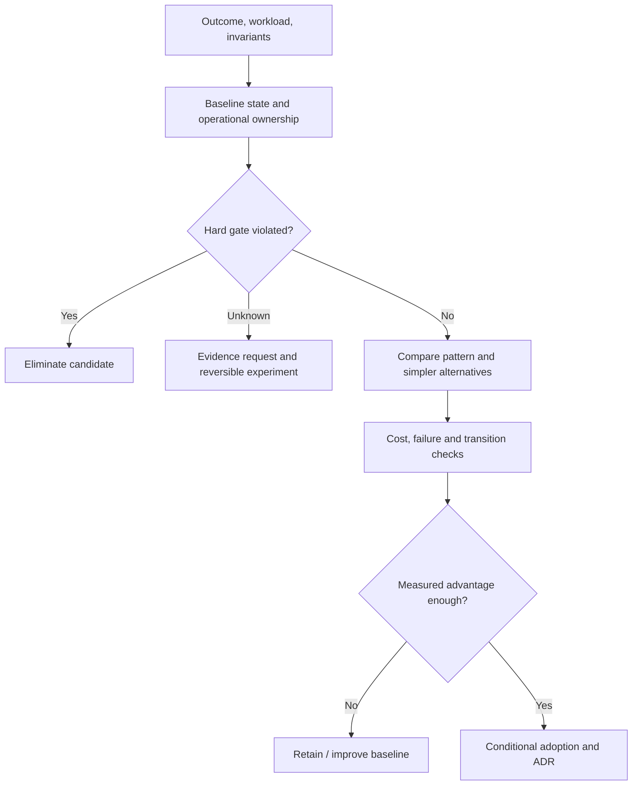

# Conditional applicability cards and baseline fit

**Owning question:** Which invariant, workload and operating precondition makes a pattern useful?

This page belongs to [V10/C03 — Pattern applicability and contraindications](README.md). Use the integrated walkthrough for the surrounding decision; the sections below own this narrower mechanism and its limits.

<!-- tycho-question-source:tycho.page.35d5be6a4e074758afff95bf3ec68bc5:1 -->
## 1. A pattern card answers a decision, not a vocabulary question

A meaningful applicability statement has six parts:

| Field | Required meaning |
|---|---|
| **Problem boundary** | Named user journey, correctness invariant, state owner and deployment/runtime context |
| **Preconditions** | Observable requirements without which the pattern's intended benefit does not apply |
| **Mechanism and gain** | The *specific* architectural constraint relaxed or capability created |
| **Costs and failure modes** | New distributed/state/resource risks, migration burden, team complexity and total cost |
| **Contraindications** | Confirmed hard-gate violations or missing capability that should reject the option |
| **Discriminator and revisit** | Minimal test that could prove/disprove benefit, and conditions for reevaluation |

An **unknown** is not automatically a contraindication. If the unknown concerns a non-negotiable data or security gate, it blocks approval until measured; if it concerns an optional quality preference, alternatives may be compared with uncertainty clearly shown. A hard failure is not made acceptable by a high weighted score.

If a pattern has several independent effects (e.g., microservices improve deployment isolation but may worsen p99), give these effects separate evidence tasks. Avoid a single red/green label for an entire style.

<!-- /tycho-question-source -->
<!-- tycho-question-source:tycho.page.35d5be6a4e074758afff95bf3ec68bc5:2 -->
## 2. Evaluate the baseline before choosing a target

The canonical [requirements/workload chapter](../c01-architecture-requirement-and-workload-profiles/requirements-and-workload-architecture-profiles.md) establishes what an architecture must achieve. The [legacy baseline](../c02-baseline-analysis-for-existing-software/legacy-baseline-and-modernization-evidence.md) establishes which parts of the existing system must coexist during change. Their outputs become a decision envelope:

Text alternative: the pattern is selected only after it passes hard constraints, can be compared against the unchanged architecture and has a falsifiable benefit sufficient to justify its implementation and operational costs. Unknown gates generate investigations, not automatic approvals.

A useful design review includes *retain, tune or modularize* as candidates. Retaining a design is not the same as doing nothing: it may entail improving tests, dependency support, instrumentation, capacity control and operational contracts.

<!-- /tycho-question-source -->
<!-- tycho-question-source:tycho.page.35d5be6a4e074758afff95bf3ec68bc5:3 -->
## 3. Worked applicability cards: deployment and communication

### Modular monolith or internal modules

**Applies if:** cohesive capabilities and shared state can live within one deployable, changes can be isolated through enforceable module boundaries and independent deployment provides little measured value.

**Benefits:** local transactional boundaries can remain simple, operational surfaces are fewer and cross-module calls do not require distributed-network fault handling. **Costs:** release/unit scaling may remain coarse, and ownership can degrade if internal boundaries are not enforced.

**Contraindications:** hard runtime-isolation requirements or proven need for independent deployment at an incompatible change cadence *may* disqualify a single deployable. A mere increase in user count is not such proof.

**Test:** inspect dependency rules and change impact, compare deployment risk and recovery under bounded changes. Read [module boundaries](../../../application/architecture-styles-and-module-boundaries.md) for the mechanism.

**Revisit if:** the named contraindication changes, the test fails, or measured
benefit no longer exceeds the stated cost.

### Service decomposition / microservices

**Applies if:** independently owned capabilities can expose stable contracts, their state ownership and consistency model can be deliberately separated, and independent deployment or failure isolation is a real requirement.

**Benefits:** independently scalable/deployable services and stronger deployment barriers, conditional on real ownership. **Costs:** network, cross-service availability, multiple deployable operations, distributed trace and transaction/retry complexity, temporary dual-version migrations.

**Contraindications:** unowned shared data writers, strict single-local-transaction invariants without a viable redesign, absent release automation/operations capacity, clients that cannot tolerate network failure, or unknown data-cutover conditions.

**Test:** an incremental boundary pilot with actual shared-state and consumer tests, rollback/forward recovery, and bounded release time. Fowler's [Microservice Trade-Offs](https://martinfowler.com/articles/microservice-trade-offs.html) explicitly warns that distribution costs can overwhelm benefits in insufficiently complex systems. Independent service count is not a quality target.

**Revisit if:** the named contraindication changes, the test fails, or measured
benefit no longer exceeds the stated cost.

### Asynchronous queue / durable workflow

**Applies if:** work can complete later than a synchronous response; durable acceptance and user-visible status are defined; volume spikes can be buffered within bounded retention/age budgets.

**Benefits:** decouples temporal demand from execution throughput and permits retry/replay policies. **Costs:** outcome uncertainty, queue ageing, duplicate effects, consumer lag, operational state and backlogs.

**Contraindications:** caller requires immediately committed final result; workflow lacks durable operation identity; replay can repeat irreversible effects; upstream keeps retrying indefinitely; retention and overload are unbounded.

**Test:** acknowledgment loss after acceptance, consumer restart after side effect, duplicate delivery, dead-letter/recovery and queue-age SLO. Read [outbox/idempotency](../../../distributed/transactional-outbox-and-idempotency.md), [Kafka](../../v04-distributed-coordination-and-events/c07-kafka-logs-partitions-and-transactions/kafka-partitions-replication-and-contracts.md) and [durable messaging choices](../../v04-distributed-coordination-and-events/c06-messaging-families-and-delivery-contracts/messaging-families-and-durable-workflows.md).

**Revisit if:** the named contraindication changes, the test fails, or measured
benefit no longer exceeds the stated cost.

<!-- /tycho-question-source -->
<!-- tycho-question-source:tycho.page.35d5be6a4e074758afff95bf3ec68bc5:4 -->
## 4. Worked applicability cards: performance and data

### Cache

**Applies if:** repeated reads dominate a costly computation, authority and invalidation are known, freshness/error policy is measurable, and extra storage/routing can be operated safely.

**Benefits:** fewer repeated authoritative reads, lower latency for selected popular values. **Costs:** stale reads, memory cost, cache stampedes, invalidation race conditions, credential/tenant leaks if scoped badly.

**Contraindications:** strong immediate freshness with no proven invalidation protocol; high write churn; low key reuse; cached data whose ownership/correctness cannot be defined.

**Test:** read hit ratio under the real key distribution, post-write freshness, cache outage fallback, hot-key and stampede injection. Read [cache correctness](../../../scaling/local-distributed-caching-and-invalidation.md).

**Revisit if:** the named contraindication changes, the test fails, or measured
benefit no longer exceeds the stated cost.

### Sharding and partitioning

**Applies if:** a measurable datastore/resource ceiling is caused by *distributable* independent key ranges, routing identity is stable and resharding/reconciliation is feasible.

**Benefits:** distributed storage/workload limits and independent partitions. **Costs:** repartitioning, cross-shard queries/transactions, hot-key skew, rebalancing and operational failure domains.

**Contraindications:** the bottleneck is one serial hot key, all operations require global atomicity, or client/schema ownership prevents safely moving keys.

**Test:** replay skew distribution, shard migration with dual-version readers, failure mid-copy, correctness of exclusive ownership and response tail. Read [shard keys and migration](../../v05-data-models-engines-and-lifecycle/c05-partitioning-sharding-and-rebalancing/shard-keys-hotspots-and-resharding.md).

**Revisit if:** the named contraindication changes, the test fails, or measured
benefit no longer exceeds the stated cost.

### Virtual threads / reactive execution

**Applies if:** I/O waiting dominates and an execution model's task/stack/flow semantics match the dependency behavior and runtime version.

**Benefits:** cheaper waiting-task concurrency or nonblocking composition for certain workloads. **Costs:** scheduling/backpressure/cancellation complexity, dependence on downstream limits and framework integration.

**Contraindications:** CPU-saturated hot path, uncontrolled shared connection pool, lack of cancellation/backpressure correctness, or chosen libraries that do not obey the required execution contract.

**Test:** compare at fixed **offered** work and downstream capacity; measure CPU, queue/pool waits, timeout, cancellation and correctness. Read [Java execution](../../v03-execution-concurrency-and-flow-control/c02-java-execution-and-virtual-threads/platform-threads-executors-and-virtual-threads.md), [reactive demand](../../v03-execution-concurrency-and-flow-control/c03-reactive-streams-demand-and-cancellation/reactor-webflux-r2dbc-and-backpressure.md) and [CPU/GC diagnostics](../../v03-execution-concurrency-and-flow-control/c06-memory-gc-cpu-and-blocking-diagnostics/cpu-memory-gc-and-blocking-diagnostics.md).

**Revisit if:** the named contraindication changes, the test fails, or measured
benefit no longer exceeds the stated cost.

<!-- /tycho-question-source -->

## Navigation, prerequisites and source scope

| Route | Destination |
|---|---|
| Parent and source ledger | [Chapter introduction and exact source rows](README.md#chapter-source-ledger) |
| Previous / prerequisite | [Read preceding context](pattern-applicability-and-contraindications.md) |
| Next | [Continue the reasoning](contraindications-transition.md) |
| Integrated question | [Original scenario and limits](pattern-applicability-and-contraindications.md) |

The source material keeps its original published/inferred/synthetic/unverified distinctions. Chapter-wide citations are shared reference context, not proof that every cited source supports every sentence on this page. Freshly inspected text is identified explicitly; absent dates and unknowns are retained.
