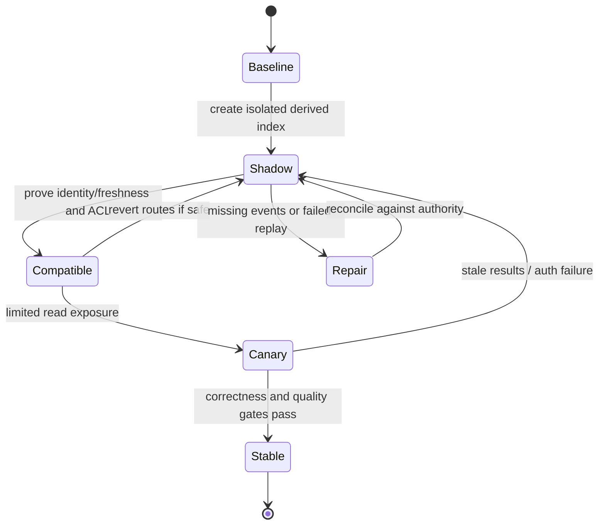

# State authority and coexistence transitions

**Owning question:** Which owner is authoritative in every real intermediate configuration?

This page belongs to [V10/C05 — Target architecture versus transition states](README.md). Use the integrated walkthrough for the surrounding decision; the sections below own this narrower mechanism and its limits.

<!-- tycho-question-source:tycho.page.cf0ce38c73e44950aec5a9c2869bee63:1 -->
## 1. Keep five distinct contracts

| Contract | Target state must say | Every transition state must additionally say |
|---|---|---|
| Functional ownership | Which capability accepts each user-visible operation | Whether old or new implementation receives each client/version |
| State authority | Where each authoritative entity is written and validated | How double-writing is prevented, which source is current, and how to reconcile |
| API/event semantics | Public operation identity, schema, ordering and errors | Old/new versions simultaneously supported, unknown outcomes and replay horizon |
| Security/operations | Trust boundaries, access control, dependency/service budget | Which principal/role may switch routing or write, and whose on-call can recover |
| Failure and recovery | Long-term RPO/RTO and availability model | Exact cutover rollback window, irreversible effects, restore and forward-repair path |

A target architecture might consist of one improved modular application; a transition need not split services. Conversely, a migration that introduces a second deployment needs extra protection even if the target only promises the same user journey.

<!-- /tycho-question-source -->

> **Pattern atlas:**
> [Parallel Run](../../v11-pattern-atlas/c10-deployment-modernization/README.md#parallel-run) — decision conditions and contraindications.

<!-- tycho-question-source:tycho.page.cf0ce38c73e44950aec5a9c2869bee63:2 -->
## 2. The fictional migration: moving a public catalogue read model

Imagine a standalone community tool catalogue that stores authoritative items and serves a query endpoint from the same runtime. The proposed target moves **read-only search projection** into a specialized index while leaving authoritative item edits in the existing store. The objective is to improve search relevance under a measured query mix, not to rewrite the data authority.

Synthetic assumptions:
- The authoritative store is the sole writer of item metadata.
- Existing clients must continue to get consistent identity and authorization semantics.
- A search projection may lag up to a **hypothetical** approved bound; no real tolerance has been obtained.
- Some callers use exact item IDs, so full-text search must not silently replace exact identity lookup.
- Events may replay, arrive late or be lost in the proposed pipeline unless recovery is designed.

A future-state description could show catalogue writes flowing to an authoritative store, a versioned event/indexing path and query reads from a search projection. But the transition also needs a migration protocol that tests exactly **which query versions and index generations** are live.

<!-- /tycho-question-source -->
<!-- tycho-question-source:tycho.page.cf0ce38c73e44950aec5a9c2869bee63:3 -->
## 3. A versioned sequence of safe intermediate states

| State | Routing and ownership | Entry gate | Exit or recovery gate |
|---|---|---|---|
| S0 — Baseline | Old query and write paths; one authoritative store | Pin code, data, client versions and key invariants | Observed baseline and restore evidence exist |
| S1 — Shadow index | Writes remain authoritative; separate index ingests copied updates; clients still read old path | Snapshot/CDC identity, event ordering and safe isolation | Compare source/index records; repair gaps without user exposure |
| S2 — Compatibility reads | A bounded subset of authorized queries uses new index; exact lookup remains authoritative | Old/new client contract, scoped access checks and freshness guard | Failed query can route back **only if** behavior/data assumptions still hold |
| S3 — Bounded promotion | More traffic uses the projection under measured lag and result-quality SLO | Equivalence/quality samples, error budget and no leakage | Revert reader route if safe; replay missing updates by stable ID |
| S4 — Stabilized | Old read path may retire after client/query inventory proves safe | No unsupported clients or queries; recovery drill approved | Removal requires independent no-return approval |

The index is **derived state**. Rebuilding it from the current authoritative store and a compatible event sequence may be safe; deleting that store is not authorized by an index migration. If the project later moves *authoritative writes*, the state machine and consistency requirements must be redesigned; the index example is not proof of safe writer migration.

Text alternative: start with one authoritative source, build a shadow projection, validate a bounded mixed-version read path, then gradually increase traffic. Failure returns to the previous safe reader path or rebuilds the projection. No automatic restoration or successful real migration is implied.

<!-- /tycho-question-source -->

## Navigation, prerequisites and source scope

| Route | Destination |
|---|---|
| Parent and source ledger | [Chapter introduction and exact source rows](README.md#chapter-source-ledger) |
| Previous / prerequisite | [Read preceding context](target-and-transition-architecture-states.md) |
| Next | [Continue the reasoning](rollback-data.md) |
| Integrated question | [Original scenario and limits](target-and-transition-architecture-states.md) |

The source material keeps its original published/inferred/synthetic/unverified distinctions. Chapter-wide citations are shared reference context, not proof that every cited source supports every sentence on this page. Freshly inspected text is identified explicitly; absent dates and unknowns are retained.

## Bounded pattern ownership notes

These notes define the decision boundary for atlas cards whose mechanism is
not the main subject of this page. They are synthetic design guidance, not
measured evidence, and they do not create a new source claim.

### Parallel Run

Parallel run processes the same work in old and new implementations and compares the
results while the old path remains authoritative. It needs a comparison key, a side-effect
boundary, a divergence owner and a rule for which path may commit. Use it when output
equality can be checked and duplicate effects can be suppressed. Do not use it when
comparison is meaningless or when the doubled cost dominates the decision.

The failure path is a silent divergence or a duplicate effect; halt promotion, reconcile
the difference and keep the old authority until the cause is understood. A canary or
shadow traffic is the alternative when full parallel processing is unnecessary.

**Limits.** Doubled compute and comparison storage are costs; a comparison that ignores
nondeterminism or side effects produces false confidence.
