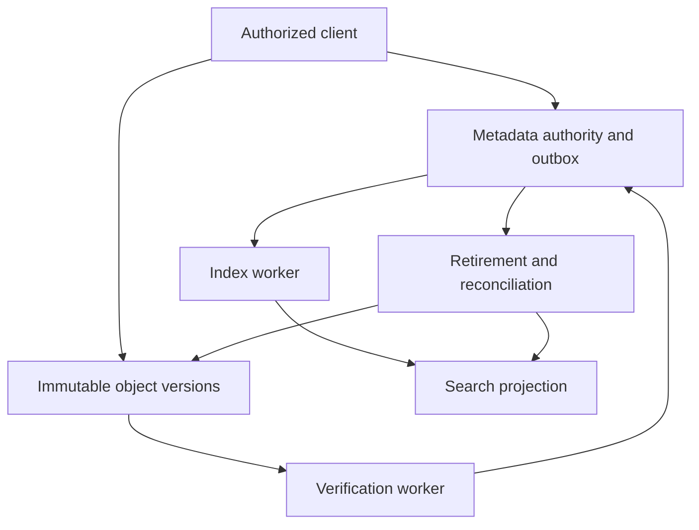

---
{
  "metadata_version": 1,
  "id": "tycho.page.ae25f40712b658ecfb9d617ca977ad35",
  "kind": "page",
  "parent_id": "tycho.chapter.5fb14670d0b24967a5e6c24df7221d74",
  "canonical_path": "book/volumes/v10-decision-support-and-modernization/c07-cross-domain-worked-comparisons-and-unresolved-cases/catalogue-project.md",
  "title": "Large-file catalogue project",
  "topic_ids": [
    "architecture-decisions"
  ],
  "perspectives": [
    "architecture",
    "evaluation",
    "operations"
  ],
  "summary": "How do upload, publication, search, retirement and restoration preserve one catalogue contract?",
  "route_hints": {
    "questions": [
      "How do upload, publication, search, retirement and restoration preserve one catalogue contract?"
    ],
    "prerequisites": [],
    "related_ids": [
      "tycho.chapter.5fb14670d0b24967a5e6c24df7221d74"
    ],
    "excludes": [
      "Original synthetic designs and proposed checks; no executed product experiment or independent acceptance."
    ],
    "keywords": [
      "large-file",
      "catalogue",
      "project",
      "upload",
      "publication",
      "search",
      "retirement",
      "restoration",
      "preserve",
      "contract"
    ]
  },
  "evidence_scope": {
    "source_ids": [
      "src.appconfig-rollout",
      "src.jepsen-session-models",
      "src.fdb-simulation"
    ],
    "claim_ids": [],
    "status": "source-linked",
    "notes": "Selected public evidence and limits are in the page ledger and dated inspection record. Scenarios, workloads and architecture decisions are original synthetic reasoning, not production observations."
  },
  "content_review": {
    "status": "self-checked",
    "reviewed_at": "2026-10-20",
    "reviewer": "Codex author; integration execution and independent acceptance pending",
    "proof_uri": null
  },
  "authored_at": "2026-10-20",
  "updated_at": "2026-10-20",
  "source_inspection_date": "2026-10-20",
  "content_verified_at": null
}
---

# Large-file catalogue project

**Owning question:** How do upload, publication, search, retirement and restoration preserve one catalogue contract?

## Contract and invented workload

This is an original worked design for a shared large-file catalogue. Every number below is an invented planning assumption, not a measured service or quoted provider price. Files become discoverable only after durable upload verification and an authorized publication. Retirement must prevent a delayed indexing event or restored backup from making an old entry visible again.

Assume 200,000 new objects per day, mean object size 20 MiB, 30-day retention of active versions, 5,000 metadata reads/s at peak and 200 searches/s at peak. Normal completion means: publish acknowledgement establishes authoritative metadata; the publishing session can read that metadata immediately; search may lag by a stated 60-second target. The 60 seconds is a target to validate, not a guarantee derived from the architecture. Downloads require authorization against current catalogue state.

Chosen architecture: immutable object versions in object storage; one authoritative metadata database with an outbox; asynchronous search projection; workers for verification, indexing and lifecycle reconciliation. Partition metadata by tenant and entry identifier if measured limits require it, while keeping each entry transition and its outbox local to one transaction.

## Why this architecture wins under these assumptions

Routing file bytes through metadata application workers would couple upload duration and retries to their scarce connections and memory. Direct multipart transfer avoids that coupling. Keeping object bytes inside the metadata database would simplify one atomic boundary but expands its storage, backup and restore workload. The chosen design instead accepts a cross-store reconciliation obligation.

Making search authoritative would confuse a delayed projection with publication and permission state. A synchronous write to both database and search would still need a recovery protocol when one succeeds and the other fails. The outbox chooses one durable authority and repeatable projection delivery.

Follow [object publication](../../v05-data-models-engines-and-lifecycle/c08-object-storage-large-transfers-and-publication/publication-consistency.md), [capability lifecycle](../../v05-data-models-engines-and-lifecycle/c08-object-storage-large-transfers-and-publication/access-lifecycle.md), [outbox ordering](../../v04-distributed-coordination-and-events/c05-outbox-inbox-sagas-and-durable-workflows/outbox-publication.md), [index lifecycle](../../v06-caching-indexing-and-retrieval/c03-lexical-full-text-indexing-and-ranking/index-lifecycle.md) and [session consistency](../../v04-distributed-coordination-and-events/c02-replication-consensus-and-leader-changes/session-consistency.md) for the canonical mechanisms.

## Ownership and data path

Text alternative: clients obtain metadata-controlled upload permission and transfer directly to versioned storage. Verification permits an authoritative publication transaction. Its outbox drives search; retirement and reconciliation maintain storage and projection lifecycle.

An entry stores tenant, entry identity, immutable object version, expected length and digest, publication generation, visibility and retention policy. Upload sessions are separate records with expiry and scoped capabilities. Search holds tenant, entry identity, publication generation and permitted searchable fields; it never grants object access merely because a hit exists.

1. An authenticated client creates an upload session with a stable request identifier. The authority validates quota and issues a bounded capability for the intended object/session.
2. The client transfers parts and completes the upload. Completion is not publication. A verifier checks the immutable completed version, declared length and digest under the chosen storage API's semantics.
3. An authorized publication transaction checks the verified version and current policy, advances the entry generation, and inserts its outbox event. A unique operation identifier prevents a response-loss retry from publishing twice.
4. An index worker applies events by entry generation. It acknowledges only after the projection has durably accepted the update; a repeated event is harmless.
5. A search result is filtered to the tenant and resolves to an authorized metadata read before download permission is issued.

The verifier's digest contract must state how multipart and encryption interact with the chosen API. Do not assume an arbitrary storage response field is the application's content digest. A malicious client cannot establish verification by asserting its own checksum.

## Retirement, crashes and recovery

Retirement advances the authoritative generation and emits a hidden-state event in one transaction. The search consumer retains the retirement generation as a fence. A delayed old publish cannot outrank it. Existing direct-download capabilities have an explicit maximum lifetime: if immediate revocation is mandatory, place an authorization gate on the serving path rather than relying on a long-lived capability.

| Interruption | Durable state and recovery |
| --- | --- |
| Upload completed, verification missing | Keep unpublished; retry verification by immutable version |
| Verification done, publish not committed | Keep a verified orphan; resume by session identity or expire after a bounded grace period |
| Publication committed, response lost | Query or retry the same operation identifier; return its established result |
| Event delivered, acknowledgement lost | Redeliver; generation and event identity prevent duplicate effect |
| Retire delivered before an older publish | Retained generation fence prevents resurrection |
| Cleanup worker restarts mid-batch | Recheck authority and version before each idempotent removal |

A cleanup worker does not delete a version simply because a delayed search index omits it. It consults authoritative publication/retention state and allows for in-flight verification. Cleanup cannot remove the version referenced by a visible entry.

Restore into an isolated environment. Restore metadata and its outbox consistently, verify that every visible reference resolves to the intended retained object version, and rebuild search from authority. A backup older than a retirement cannot by itself tell us about that later retirement. The selected recovery contract therefore preserves a separately durable lifecycle journal through the declared recovery point and replays it before serving. If that journal is lost in the same event, the design cannot promise preservation of later retirements: keep service closed until a reviewed recovery decision resolves that gap.

## Capacity and cost arithmetic

Daily logical ingress is 200,000 × 20 MiB = 4,000,000 MiB, approximately 3.815 TiB. Thirty days of one retained copy requires approximately 114.44 TiB before incomplete uploads, older versions, replica overhead and safety headroom. At a purely illustrative price p per GiB-month, the 117,187.5 GiB logical footprint costs 117,187.5p per month. A chosen provider's billed units, replication and retrieval tiers must replace that placeholder.

If 10% of objects are downloaded once daily, egress is 400,000 MiB/day, approximately 390.625 GiB/day. That can dominate metadata compute. A mean five-minute transfer implies approximately 2.315 arrivals/s × 300 s = 694 concurrent uploads under a stable average. This average says nothing about the peak or multipart request rate; both require a workload distribution.

Budget verification reads, abandoned parts, lifecycle operations, index writes and recovery reindex separately. The architecture is feasible only if the actual connection, request, storage and transfer limits leave headroom for recovery while serving useful traffic.

## Acceptance and conditions that reverse the decision

Proposed tests inject every interruption in the table, reorder generations, revoke access during transfer, restore a snapshot preceding retirement, and lose an index. Oracles: visible entries reference verified immutable versions; only authorized requests obtain access; no stale event reverses retirement; repeated publication has one effect; rebuilt search agrees with authority at the declared watermark. Measure the search-lag target separately. None of these tests or cost measurements was executed.

Choose a simpler transactional byte store if objects are small enough and cross-store recovery costs exceed its storage burden. Choose a serving authorization gateway if revocation latency must be shorter than capability expiry. Reconsider the retention design if recovery cannot preserve the lifecycle journal, or if legal product requirements demand deletion semantics incompatible with retained backups.

[Deploying configuration](https://docs.aws.amazon.com/appconfig/latest/userguide/appconfig-deploying.html) supports staged activation of parser changes, not atomic object publication. [Consistency models](https://jepsen.io/consistency/models) supplies consistency terminology. [Simulation and Testing](https://github.com/apple/foundationdb/blob/f314e81f8ee1d2eeff4a35d4d658c47287f08e89/documentation/sphinx/source/testing.rst) motivates fault exploration as a method, not evidence that this design was tested. All workload values, decisions, crash traces and calculations are original; product-specific storage and outbox claims remain scoped to the linked canonical pages.
