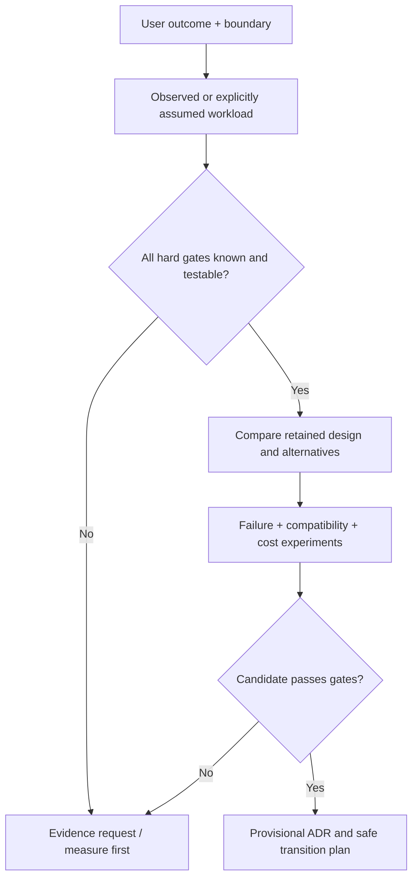

# Adversarial requirements and candidate screening

**Owning question:** Which missing evidence or hard gate must block a premature recommendation?

This page belongs to [V10/C01 — Architecture requirement and workload profiles](README.md). Use the integrated walkthrough for the surrounding decision; the sections below own this narrower mechanism and its limits.

<!-- tycho-question-source:tycho.page.868027aee4884210bea1d8a6542fbfb0:4 -->
## 4. Turn qualities into adversarial scenarios

A quality attribute should have a stimulus, affected boundary, environment, expected response and measurable acceptance criterion. In the fictional booking system, these would be **proposed experiments**:

| Scenario | Stimulus and environment | Observable criterion | Architectural question |
|---|---|---|---|
| Concurrency correctness | Two clients reserve same slot simultaneously | At most one committed owner; both get consistent final results | Which datastore transaction or compare-and-set boundary enforces this? |
| Client uncertainty | Reply is lost after durable commit | Same logical retry yields original booking, no duplicate | Where is durable operation identity stored? |
| Capacity peak | 100 offered attempts/s for 20 seconds with configured skew | Defined admission/success/latency envelope; no invisible loss | Which resource saturates first? |
| Dependency outage | Notification provider unavailable | Booking truth remains queryable; notifications eventually resolved according to policy | Can notification be decoupled without changing core outcome? |
| Changeability | Booking rule extended while old clients remain | Named old/new client matrix and tests pass | Is API/schema evolution independently safe? |
| Recovery | Instance restarted with in-flight operations | Reconciliation produces correct durable results | Can locks, commands and offsets be recovered? |

The quality target may have to change after constraints and system boundaries are better understood. A scenario that is impossible without an unaffordable architectural change must be renegotiated explicitly, not silently omitted from the benchmark.

<!-- /tycho-question-source -->
<!-- tycho-question-source:tycho.page.868027aee4884210bea1d8a6542fbfb0:5 -->
## 5. Separate evidence classes to prevent false certainty

Use a small, reusable evidence ledger for any consequential profile claim:

| Evidence state | What the profile may assert |
|---|---|
| Stakeholder requirement | A desired behavior exists; not that it is currently achieved |
| Instrumented observation | A measured ratio or event for a specified population/time/source/version |
| Reproduced test | Behavior occurred in a bounded setup; not a timeless production guarantee |
| Public vendor/standard text | How a protocol or implementation claims to behave at an identified version |
| Derived model | A mathematical or architecture inference under stated assumptions |
| Unknown | A missing measurement/ownership/compatibility check that must be requested |

This original classification applies general principles from [SEI ATAM](https://www.sei.cmu.edu/library/architecture-tradeoff-analysis-method-collection/) and Tycho's [evidence-first research method](../../../../authoring/METHODOLOGY.md). It is not a claim that the fictional measurements happened.

An author must record which of these states applies to each *important* claim, not only a global "verified" badge. A design's assumptions—like independent queues, immutable IDs or lossless retries—must be falsifiable. A reference to a published API contract supports contract semantics but does not prove a client implementation adheres to it.

<!-- /tycho-question-source -->
<!-- tycho-question-source:tycho.page.868027aee4884210bea1d8a6542fbfb0:6 -->
## 6. Candidate screening before preference scoring

Suppose the team proposes three alternatives:

| Option | Baseline owner | Potential benefit | Risk and proof required |
|---|---|---|---|
| A — retain modular application and improve contention handling | Same transactional owner | Lowest migration surface; consistent data boundary | Verify lock/transaction semantics and measured peak ceiling |
| B — add bounded admission and a durable job queue | Same committed booking authority, with asynchronous acceptance | Stabilizes offered work when synchronous final outcome is not mandatory | Requires client consent to async completion; deduplication and recovery contract |
| C — extract separately deployed booking service | New runtime boundary; data ownership must be transferred deliberately | Independent deployment or resource isolation if evidence justifies it | Mixed-client compatibility, remote failures, durable cutover and total operating cost |

**Hard gate first:** if a client contract requires the *final* booking decision within 700 ms, option B is invalid until the contract or implementation proves that an asynchronous acceptance can satisfy the actual user journey. If one state owner is mandatory during coexistence, C must provide a safe migration with no double-writer gap. Unknown bottleneck data make none of these a proven scale solution.

Only after all gates are satisfied may preference comparisons assign relative weights to simplicity, cost, flexibility or latency. Check whether modest changes in assumed workloads or weights reverse the preferred option. [Candidate comparison and ADR model](../../../../authoring/models/candidate-comparison-adr.md) owns reusable scoring details; this book chapter explains when scoring would be invalid.

Text alternative: requirements are translated into a workload and hard gates; insufficient evidence produces an evidence request rather than a technology recommendation. Only viable candidates receive deeper experiments and a *provisional* record. Publication of this flow does not automate architecture approval.

<!-- /tycho-question-source -->
<!-- tycho-question-source:tycho.page.868027aee4884210bea1d8a6542fbfb0:7 -->
## 7. Outcome of the fictional analysis

**Decision:** keep the current transactional owner and first measure actual key skew, queue wait, lock conflicts and accepted/completed outcomes under a replayable 20-second burst. This is **MEASURE_FIRST**, not a finding that one implementation is fast enough.

**Falsifiable hypotheses:** (H1) a small set of hot slots dominates contention; (H2) retries create duplicate offered demand; (H3) the notification provider occupies synchronous worker resources. Tests must distinguish competing causes rather than retroactively fitting an expected solution.

**Change/revisit triggers:** if measured multi-key load demonstrates separable state ownership and deployment cycles diverge, service extraction becomes more plausible. If one hot key remains dominant, sharding or more app replicas may not help. If the final-result deadline proves infeasible, options include changing service-level expectations or presenting a durable accepted/pending state only with an explicitly changed contract.

**Reader takeaway:** requirements and workloads do not select architecture automatically; they make a design decision *falsifiable*. This same profile supports later [legacy baseline assessment](../../../../authoring/models/legacy-modernization-profile.md), [pattern contraindications](../../../../authoring/models/pattern-applicability-card.md) and [cross-domain decisions](../c07/cross-domain-modernization-and-adr-examples.md).

<!-- /tycho-question-source -->

## Navigation, prerequisites and source scope

| Route | Destination |
|---|---|
| Parent and source ledger | [Chapter introduction and exact source rows](README.md#chapter-source-ledger) |
| Previous / prerequisite | [Read preceding context](intake-invariants.md) |
| Next | [Continue the reasoning](README.md) |
| Integrated question | [Original scenario and limits](requirements-and-workload-architecture-profiles.md) |

The source material keeps its original published/inferred/synthetic/unverified distinctions. Chapter-wide citations are shared reference context, not proof that every cited source supports every sentence on this page. Freshly inspected text is identified explicitly; absent dates and unknowns are retained.
