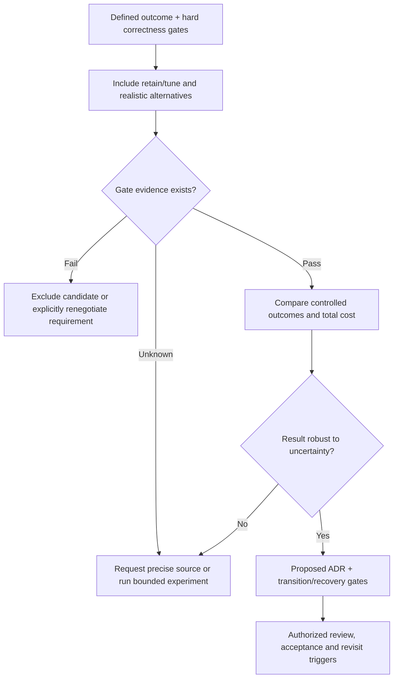

# Sensitivity, consequences and stopping rules

**Owning question:** When must a scored preference or recorded ADR be reconsidered?

This page belongs to [V10/C04 — Alternatives, experiments and ADRs](README.md). Use the integrated walkthrough for the surrounding decision; the sections below own this narrower mechanism and its limits.

<!-- tycho-question-source:tycho.page.f05854fcc406435bbf38a192bc7ab2f1:4 -->
## 4. Conditional preference scoring and sensitivity

After hard gates pass, a *hypothetical* 0–5 preference matrix may help expose stakeholder priorities:

| Preference | Weight | Retain/tune A | Extract service C |
|---|---:|---:|---:|
| Operational simplicity | 0.5 | 4 | 2 |
| Independent deployment | 0.3 | 2 | 5 |
| Migration effort | 0.2 | 5 | 2 |
| Weighted illustrative result | 1.0 | 3.60 | 2.90 |

These numbers are **invented subjective ratings**, not benchmarks. If independent deployment becomes the dominant documented requirement, the rank can reverse. More importantly, if one contender cannot meet a hard exclusivity or restore gate, numerical scores become irrelevant.

For a sensitivity check: define ranges for every uncertain cost/benefit estimate, perturb weights within agreed stakeholder bounds, and explicitly report whether the ranking changes. A wide outcome interval means **decision sensitivity**, not false numerical confidence.

<!-- /tycho-question-source -->
<!-- tycho-question-source:tycho.page.f05854fcc406435bbf38a192bc7ab2f1:5 -->
## 5. ADRs document consequences and update history

An architecturally significant decision record should carry:

- stable ID, title, responsible reviewer, date and status;
- affected user journey, versions, exact scope and change trigger;
- known inputs and unknowns with source/revision;
- alternatives, including the retained design, and hard-gate table;
- observed versus hypothesized findings; falsifiers and tests;
- positive, negative and neutral consequences;
- transition and irreversible-effect gates;
- explicit status **PROPOSED**, **ACCEPTED**, **SUPERSEDED** or **DEFERRED** as appropriate;
- review trigger and pointer to a superseding record.

Do not silently replace an accepted decision with a new paragraph: a later ADR should state which earlier reasoning was superseded and by which changed facts. A GitHub issue closed for documentation is **not** a business approval of an architecture. The [arc42 §9](https://docs.arc42.org/section-9/) description of decision status and traceable consequences supports maintaining that distinction.

### Original proposed ADR — reservation burst

**Title:** ADR-SYN-07, Retain single reservation authority during burst diagnosis  
**Status:** PROPOSED; no person or production team approved it.

**Context:** exclusive allocation required; offered burst, lock waits, clients and cost are presently unknown.  
**Alternatives:** A retain/instrument; B bounded admission; C extract service.  
**Hard gates:** one accepted owner per unit/time; stable client effect identity; data recovery and authorized writes.  
**Decision:** **MEASURE_FIRST**; temporarily prefer smallest reversible baseline instrumentation.  
**Reasons:** no demonstrated independent data ownership or deployment advantage yet; distributing the writer would add a new failure and migration boundary.  
**Costs:** instrumenting and testing consumes work; retaining shared deployment may delay independently desirable changes.  
**Falsifier:** a verified independent capability repeatedly causes unacceptable release or resource coupling that simpler changes cannot satisfy.  
**Revisit:** when key skew, parent latency, owner mapping and the transition compatibility matrix are measured and reviewed.

This is a *worked writing example*. A real decision would require actual stakeholder approval and a fresh evidence ledger.

<!-- /tycho-question-source -->
<!-- tycho-question-source:tycho.page.f05854fcc406435bbf38a192bc7ab2f1:6 -->
## 6. A decision is also a stopping rule

Text alternative: after framing a decision, generate real alternatives; unknown hard-gate evidence leads to investigation and a failed gate excludes the candidate. Compare only feasible options, challenge assumptions, and record a proposal that requires explicit authorized approval.

Research may conclude **no feasible candidate under current constraints**, **defer**, or **insufficient evidence**. Neither a book chapter nor a search/agent service should quietly turn these outcomes into a fabricated architecture recommendation.

<!-- /tycho-question-source -->

## Navigation, prerequisites and source scope

| Route | Destination |
|---|---|
| Parent and source ledger | [Chapter introduction and exact source rows](README.md#chapter-source-ledger) |
| Previous / prerequisite | [Read preceding context](decision-discriminators.md) |
| Next | [Continue the reasoning](README.md) |
| Integrated question | [Original scenario and limits](architecture-alternatives-experiments-and-adrs.md) |

The source material keeps its original published/inferred/synthetic/unverified distinctions. Chapter-wide citations are shared reference context, not proof that every cited source supports every sentence on this page. Freshly inspected text is identified explicitly; absent dates and unknowns are retained.
