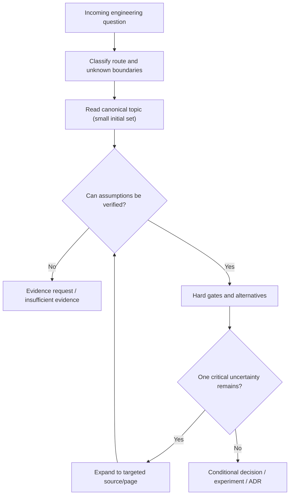

# Intent classification and selective reading

**Owning question:** Which canonical explanation must be read before composing an answer?

This page belongs to [V10/C06 — Search and question routes for architecture agents](README.md). Use the integrated walkthrough for the surrounding decision; the sections below own this narrower mechanism and its limits.

<!-- tycho-question-source:tycho.page.ca056fe720e74a9691ce0c253d9526fc:1 -->
## 1. First classify the intent before fetching pages

Four initial question families are sufficient for many practical requests:

| Entry family | Example | Next question | Typical canonical starting material |
|---|---|---|---|
| Requirement | "Need 100 requests/second at peak" | Which *user journey*, arrival mix, time window, correctness, and end-to-end SLO? | [Requirements/workload](../c01/requirements-and-workload-architecture-profiles.md), [Queueing](../../v07/c01/queueing-littles-law.md) |
| Symptom | "p99 increased after a release" | Where is the measured critical path, and which alternative cause fits the same observation? | [Tail latency](../../v07/c04/tail-latency-fanout-and-deadline-budgets.md), [CPU/GC/blocking](../../v03/c06/cpu-memory-gc-and-blocking-diagnostics.md) |
| Existing-system constraint | "Cannot change the data store and callers at once" | Who owns writes, transactions, protocol versions and recoverable transition states? | [Legacy baseline](../c02/legacy-baseline-and-modernization-evidence.md), [Schema evolution](../../../delivery/progressive-delivery-and-schema-evolution.md) |
| Modernization objective | "Want independent deployment and lower risk" | Is there a separable capability and measured need, or is internal modularization enough? | [Architecture evolution](../../../application/architecture-evolution-and-extraction.md), [Cross-domain ADR](../c07/cross-domain-modernization-and-adr-examples.md) |

A query can belong to multiple families. "Modernize the slow service" combines symptom, legacy and objective; route by the **uncertainty that could invalidate the decision**, not by keywords alone. If no clear user outcome exists, ask for it before enumerating technologies.

<!-- /tycho-question-source -->
<!-- tycho-question-source:tycho.page.ca056fe720e74a9691ce0c253d9526fc:2 -->
## 2. The progressive reading strategy

1. Identify the desired decision and **boundary** (actor, workflow, source authority and failure class). Without it, a broad phrase like "best architecture" lacks decision semantics.
2. Select **one to three** highly relevant canonical pages for orientation, prioritizing the directly owned mechanism and its counterpart or contraindication. This is a useful first-pass heuristic, not a correctness ceiling.
3. Open the **exact evidence ledger and version** for claims that change the recommendation. A summary without exact provenance is not enough for a consequential change.
4. Expand only into dependencies that resolve a concrete open question: e.g. a retry-safety concern leads from RPC deadlines to idempotency, not to every distributed systems chapter.
5. Compare viable options—including *retaining the existing design*—against hard gates before scoring preferences.
6. Stop when decision conditions, support and gaps are bounded. Return a decision state plus next falsifiable action, rather than simply a larger summary.

Text alternative: begin with the reader's question, identify its evidence boundary, read the smallest useful canonical material and check assumptions. Expand through specific dependencies only when needed. If hard gates remain unknown, return an evidence request; otherwise compare alternatives and issue a conditional decision.

<!-- /tycho-question-source -->
<!-- tycho-question-source:tycho.page.ca056fe720e74a9691ce0c253d9526fc:3 -->
## 3. Retrieval relevance is not evidence validity

A page may rank first because it contains the exact words "microservice performance" while discussing a different workload, software release or simulated measurement. Separate:

- **Topical relevance:** Does the page address the same mechanism/question?
- **Applicability:** Does its workload, runtime, data ownership, failure assumption and version match?
- **Source reliability:** Is it a verified public specification, an independently reproducible test, a vendor report or unverified interpretation?
- **Recency/version:** Is the statement applicable to the target runtime and protocol revision?
- **Citation sufficiency:** Does the exact source section support the actual claim being made?
- **Contradictions:** Does another source show a counterexample or narrower guarantee?
- **Permission:** Is the caller entitled to access the document or its metadata?

High semantic similarity is not correctness; a complete source record is not automatic proof of production behavior. A search system must not silently promote a citation from "source describes version X" to "our current system runs X".

<!-- /tycho-question-source -->

## Navigation, prerequisites and source scope

| Route | Destination |
|---|---|
| Parent and source ledger | [Chapter introduction and exact source rows](README.md#chapter-source-ledger) |
| Previous / prerequisite | [Read preceding context](question-routes-for-architecture-analysis.md) |
| Next | [Continue the reasoning](evidence-safety.md) |
| Integrated question | [Original scenario and limits](question-routes-for-architecture-analysis.md) |

The source material keeps its original published/inferred/synthetic/unverified distinctions. Chapter-wide citations are shared reference context, not proof that every cited source supports every sentence on this page. Freshly inspected text is identified explicitly; absent dates and unknowns are retained.
