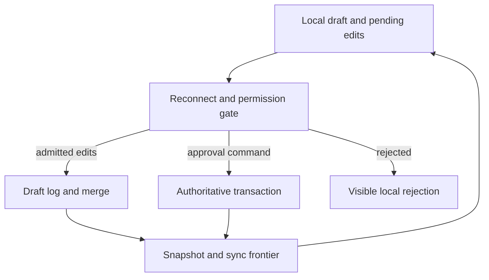

---
{
  "metadata_version": 1,
  "id": "tycho.page.8743d09eab614132692f934fb22c5649",
  "kind": "page",
  "parent_id": "tycho.chapter.5fb14670d0b24967a5e6c24df7221d74",
  "canonical_path": "book/volumes/v10/c07/collaboration-project.md",
  "title": "Offline collaboration project",
  "topic_ids": [
    "architecture-decisions"
  ],
  "perspectives": [
    "architecture",
    "evaluation",
    "operations"
  ],
  "summary": "Which offline edits can remain available while approvals and permissions retain an authoritative boundary?",
  "route_hints": {
    "questions": [
      "Which offline edits can remain available while approvals and permissions retain an authoritative boundary?"
    ],
    "prerequisites": [],
    "related_ids": [
      "tycho.chapter.5fb14670d0b24967a5e6c24df7221d74"
    ],
    "excludes": [
      "Original synthetic designs and proposed checks; no executed product experiment or independent acceptance."
    ],
    "keywords": [
      "offline",
      "collaboration",
      "project",
      "which",
      "edits",
      "remain",
      "available",
      "while",
      "approvals",
      "permissions",
      "retain",
      "authoritative",
      "boundary"
    ]
  },
  "evidence_scope": {
    "source_ids": [
      "src.replicated-types-semantics",
      "src.jepsen-monotonic-reads",
      "src.jepsen-read-your-writes"
    ],
    "claim_ids": [],
    "status": "source-linked",
    "notes": "Selected public evidence and limits are in the page ledger and dated inspection record. Scenarios, workloads and architecture decisions are original synthetic reasoning, not production observations."
  },
  "content_review": {
    "status": "self-checked",
    "reviewed_at": "2026-10-20",
    "reviewer": "Codex author; integration execution and independent acceptance pending",
    "proof_uri": null
  },
  "authored_at": "2026-10-20",
  "updated_at": "2026-10-20",
  "source_inspection_date": "2026-10-20",
  "content_verified_at": null
}
---

# Offline collaboration project

**Owning question:** Which offline edits can remain available while approvals and permissions retain an authoritative boundary?

## Contract and workload assumptions

Design an original collaboration service where disconnected users edit descriptions, add comments and propose labels, while approvals, publication and access remain authoritative. Numbers are invented planning inputs: 40,000 daily active clients, 5,000 simultaneously connected at peak, 200 edits per active client per day, and at most seven days of supported offline operation. A client disconnected longer must resynchronize before replaying edits.

The product contract permits a local draft to accept edits immediately. It does not promise that those edits are authorized for shared publication. On reconnection, the client distinguishes durable receipt, merged draft visibility, and authoritative approval. Conflicts and rejected actions remain visible to their author.

Choose a typed edit log plus periodic snapshots for draft state, a transactional authority for access and approval, and an asynchronous synchronization service. This is deliberately a hybrid: descriptions use retained concurrent alternatives where automatic resolution would lose intent; labels use explicit observed-remove semantics; comments use unique append identities; approval is a conditional authoritative command.

## Chosen boundaries and rejected alternatives

A single last-writer timestamp for an entire document is simple but can discard independent edits and gives clock order undue authority over intent. A universal automatic merge cannot preserve a finite approval limit when disconnected replicas each grant the last available slot. A fully online authoritative editor would simplify permission checking, but fails the declared offline drafting requirement.

Follow [multiwriter conflicts](../../v04/c03/multiwriter-conflicts.md), [session observations](../../v04/c02/session-consistency.md), [ambiguous retries](../../v04/c04/retries-idempotency-and-ambiguous-effects.md), and [object permission](../../v09/c05/object-credentials.md) for the mechanisms this project composes.

The authority owns workspace membership epoch, object identity, approval version and permission policy. The draft service owns admitted edit history, snapshot frontier and merge semantics version. The client owns an encrypted local queue and a stable device incarnation; local storage access is outside the guarantee of a later server-side revocation.

Text alternative: reconnecting clients pass a permission gate. Admitted draft edits merge into the draft log; approval commands go to an authoritative transaction. Rejections remain visible, and accepted state returns with a synchronization frontier.

## Normal operation and a worked conflict

Every edit identifies workspace, document incarnation, device incarnation, operation identifier, causal context and merge-semantics version. The server validates current permission before durable admission. A receipt says which edits were stored; a separate frontier describes the state the client has observed. A receipt is not a transferable permission capability.

In an original example, two disconnected clients see description “Initial scope.” One changes it to “Narrow scope,” the other to “Expanded scope.” The service retains concurrent alternatives and presents a conflict. A resolution edit names both alternatives and writes “Narrow scope with an optional extension.” That explicit resolution causally follows the conflict; a later delayed edit that was concurrent with it must still be evaluated under the data type's declared rule.

For labels, an unseen concurrent add can survive a remove. The interface explains that outcome and permits a new removal after observing the add. Comments are immutable append records with stable identifiers; modifying a comment creates a new version rather than guessing whether two different texts with one identifier are duplicates.

Approval reads the current authoritative draft frontier, approval version and permission. The frontier identifies an immutable admitted snapshot by digest; the approval authority validates that snapshot's admission evidence and checks current permission in the same authority boundary as the conditional approval. If that cross-service evidence cannot be established, approval waits. A conditional transaction records the approved frontier and next approval version. Later draft edits do not silently become part of that approval. Republishing requires a new command against the intended frontier.

## Revocation while offline

Suppose a device disconnects at membership epoch 12, creates edits, and reconnects after its access was revoked at epoch 13. The server rejects shared admission under the chosen policy, regardless of the device's claimed creation time. The device may keep a clearly local draft or export it according to the product's local-data policy. It must not show an authoritative success badge.

A stricter product may prevent local viewing after a short capability expires, but cannot guarantee erasure of information already copied by an authorized disconnected client. That limitation belongs in the product contract. Server-side revocation immediately governs future authoritative access and sync, not every past local copy.

If business policy instead permits pre-revocation edits, it needs trusted evidence of their admissibility. A user-controlled timestamp is insufficient. This design chooses current-permission admission to avoid that additional offline authority protocol.

## Failures, compaction and recovery

| Failure | Required behavior |
| --- | --- |
| Response lost after edit admission | Retry same operation identifier; return the established receipt |
| Client resets local storage | Allocate a new device incarnation; never reuse old component identity |
| Changes delivered out of order | Retain unresolved dependencies or reject with a resync instruction; never invent causal context |
| Approval response lost | Query the durable command result before showing a new approval |
| Client returns after supported offline window | Fetch a fresh snapshot and expose unsupported pending work for explicit reconciliation |
| Snapshot restore loses admitted log suffix | Restore matching snapshot/log frontier; disclose any data loss allowed by the recovery contract |

Compaction retains the metadata needed to prevent removed data from returning. A seven-day offline limit is useful only if enforced through membership/sync epochs: an expired replica cannot inject changes as if it remained in the current compacted history. The reconnect protocol first validates epoch and snapshot compatibility, then admits eligible edits.

Backups include snapshots, unapplied log suffix, authoritative approval records, permissions and their consistent recovery boundary. After restore, rebuild draft state from snapshot plus suffix and verify every approval still names an available frontier. If an approval references a missing frontier, quarantine it for recovery rather than attaching it to a different draft.

## Capacity and cost model

The invented workload generates 40,000 × 200 = 8,000,000 edits/day, approximately 92.6 edits/s averaged over a full day. A deliberately assumed peak factor of 20 gives roughly 1,852 edits/s for initial sizing, subject to measurement. If a serialized edit averages 600 bytes, raw edit payload is 4.8 GB/day in decimal units, or 33.6 GB for seven days. This excludes indexes, causal metadata, replication, snapshots and backups.

A client accumulating 200 edits/day for seven days queues 1,400 edits, approximately 0.84 MB of raw payload. If 1,000 such clients reconnect together, the service receives 1.4 million queued edits before any fresh work. Admission must pace synchronization by tenant and document rather than allowing recovery traffic to starve current edits.

Budget persistent connections separately from edit throughput. At an illustrative 32 KiB of application buffer per connected client, 5,000 clients consume about 156.25 MiB before runtime, transport and message state. That is an assumption to validate, not a universal per-connection cost.

## Acceptance, reversal and evidence

Proposed checks permute duplicate and delayed edits, conflict resolution, revocation during disconnection, device reset, compaction and snapshot restore. Require convergence for the same admitted change set, no duplicate comment effect, preservation of explicit conflicts, no unapproved frontier presented as approved, and session reads that retain their required frontier. Test overload from mass reconnection independently. No implementation or checker was run.

Choose online-only editing when approvals dominate and offline drafts add little value. Choose a different merge model if users consistently reject these conflict outcomes. Increase or remove the offline window only after redesigning compaction, permission and retention obligations; changing a timeout alone is insufficient.

[Replicated Data Types: Specification, Verification, Optimality](https://www.microsoft.com/en-us/research/publication/replicated-data-types-specification-verification-optimality/) grounds the distinction between deterministic replicated semantics and application meaning; inspection was limited to introductory sections. [Monotonic reads](https://jepsen.io/consistency/models/monotonic-reads) and [Read your writes](https://jepsen.io/consistency/models/read-your-writes) ground session expectations, not this synchronization implementation. The workload, hybrid design, revocation policy and acceptance oracles are original.
