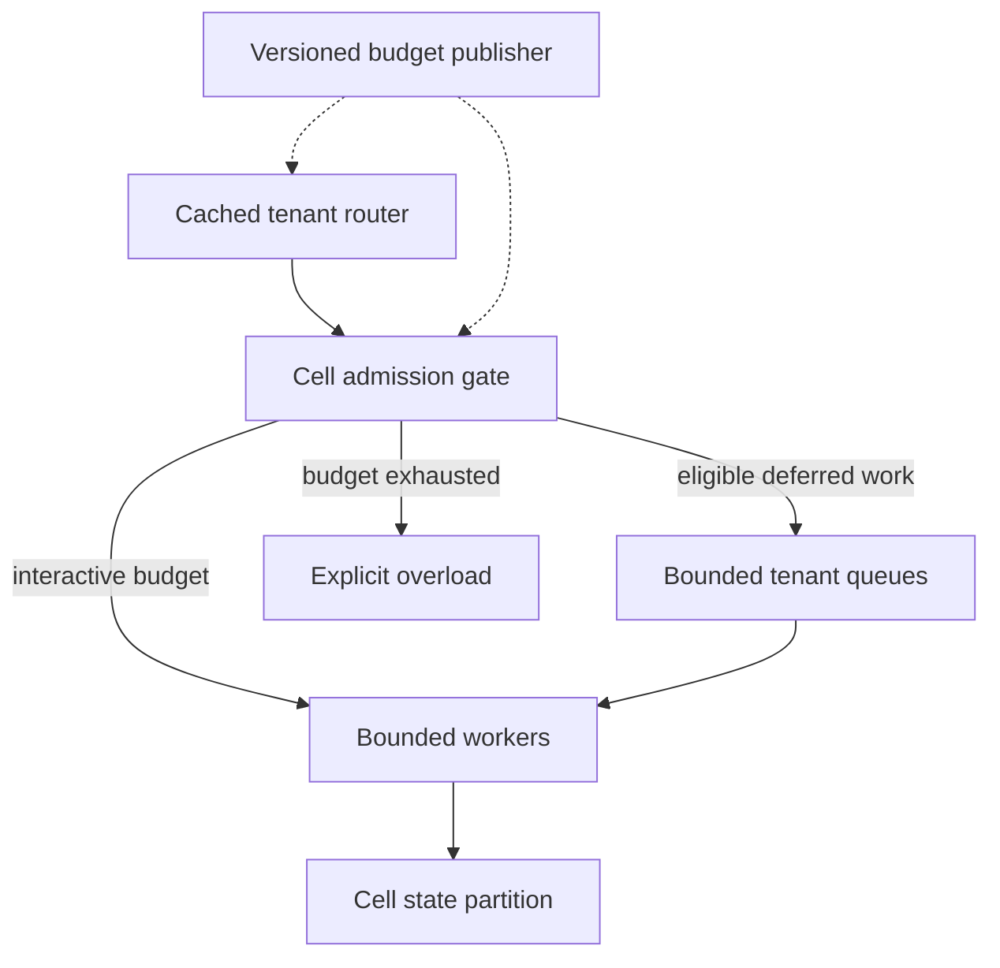

---
{
  "metadata_version": 1,
  "id": "tycho.page.4856fd39b7e1bfa3b7430427192179fa",
  "kind": "page",
  "parent_id": "tycho.chapter.5fb14670d0b24967a5e6c24df7221d74",
  "canonical_path": "book/volumes/v10/c07/multitenant-project.md",
  "title": "Overloaded multitenant service project",
  "topic_ids": [
    "architecture-decisions"
  ],
  "perspectives": [
    "architecture",
    "evaluation",
    "operations"
  ],
  "summary": "How do tenant placement, budgets and bounded cells preserve useful service through overload and rollout failure?",
  "route_hints": {
    "questions": [
      "How do tenant placement, budgets and bounded cells preserve useful service through overload and rollout failure?"
    ],
    "prerequisites": [],
    "related_ids": [
      "tycho.chapter.5fb14670d0b24967a5e6c24df7221d74"
    ],
    "excludes": [
      "Original synthetic designs and proposed checks; no executed product experiment or independent acceptance."
    ],
    "keywords": [
      "overloaded",
      "multitenant",
      "service",
      "project",
      "tenant",
      "placement",
      "budgets",
      "bounded",
      "cells",
      "preserve",
      "useful",
      "through",
      "overload",
      "rollout"
    ]
  },
  "evidence_scope": {
    "source_ids": [
      "src.cell-boundaries",
      "src.shuffle-shard-isolation",
      "src.appconfig-rollout",
      "src.appconfig-validation"
    ],
    "claim_ids": [],
    "status": "source-linked",
    "notes": "Selected public evidence and limits are in the page ledger and dated inspection record. Scenarios, workloads and architecture decisions are original synthetic reasoning, not production observations."
  },
  "content_review": {
    "status": "self-checked",
    "reviewed_at": "2026-10-20",
    "reviewer": "Codex author; integration execution and independent acceptance pending",
    "proof_uri": null
  },
  "authored_at": "2026-10-20",
  "updated_at": "2026-10-20",
  "source_inspection_date": "2026-10-20",
  "content_verified_at": null
}
---

# Overloaded multitenant service project

**Owning question:** How do tenant placement, budgets and bounded cells preserve useful service through overload and rollout failure?

## Workload and service contract

Build an original multitenant document-transformation service that remains useful during a tenant burst, a poison input and a failed configuration rollout. All numerical values are invented planning assumptions. There are 12,000 tenants, eight serving cells, and a normal peak of 9,600 work units/s across the fleet. One work unit represents an estimated 10 ms of CPU for the reference transformation; expensive operations can consume several units.

The product admits short interactive requests and defers larger jobs. It promises a bounded response deadline or an explicit overload response, not successful execution of unlimited work. Tenant isolation is evaluated against compute, queue, state-store and outbound-service contention. Regional failure remains a separate recovery contract; a cell boundary does not eliminate it.

Choose durable tenant placement, per-cell state partitions and queues, per-tenant work/concurrency budgets, and a small shared routing tier with cached placement epochs. Keep new placement and budget publication off the steady-state critical path.

## Resource arithmetic and placement decision

Assume each cell has 32 effective CPU cores. At 10 ms CPU/unit, the theoretical CPU ceiling is 3,200 units/s per cell. Choose a planning ceiling of 50% of that value, or 1,600 units/s, pending actual workload and tail-latency measurements. Eight cells provide 12,800 planned units/s against the invented peak of 9,600, a 75% planned utilization.

The arithmetic alone does not establish one-cell failover. Seven cells offer 11,200 units/s in aggregate, but state placement, per-tenant skew, connection budgets and migration time may prevent using it. Reserve recovery capacity in the actual destination cells or accept a declared degraded envelope. Never spread an overloaded tenant fleet-wide merely because the sum looks adequate.

Assign each tenant one active cell for authoritative state. Within a cell, a shuffle-shard worker subset can limit some compute contention, provided its eligible workers have sufficient capacity. Do not use independent random database ownership for every request: that would turn cell state into a shared multiwriter problem.

Follow [cell boundaries](../../v08/c06/cells-shuffle-sharding.md), [admission resources](../../v07/c05/admission-resource.md), [fleet budgets](../../v03/c05/fleet-budgets.md), [retry retention](../../v04/c04/retry-retention.md), and [configuration rollout](../../v08/c04/configuration-rollout.md) for the canonical mechanisms.

## The admitted path

Text alternative: a cached router selects the owning cell; admission sends eligible work to bounded workers or queues and rejects exhausted budgets. Workers use cell-owned state. A versioned publisher updates routing and limits without serving every request.

A request carries authenticated tenant, operation identifier, deadline and estimated cost class. Admission validates body size before expensive parsing, charges a work budget, and obtains a concurrency slot. It never trusts a client's asserted cheap cost class. The worker measures actual use and aborts or reclassifies excessive work under a defined policy; estimation errors remain a risk to contain.

An original standard tenant receives 100 units/s with a 200-unit burst allowance and four concurrent interactive operations. These are example policy values, not quotas for all 12,000 tenants: provisioning checks the assigned population and aggregate cell envelope. A single unbounded global first-come queue would let a burst consume every waiting slot.

At the assumed cell rate of 1,600 units/s, a queue of 400 one-unit operations represents 250 ms of service demand even before variability. Set a 400-unit queue ceiling for this planning example and reject work whose predicted wait cannot fit its remaining deadline. Request count alone is insufficient when one transformation costs 100 units. Deferred work has separate capacity and age limits; it is not an unlimited overflow queue.

## Three failures and explicit recovery

**Tenant burst.** A tenant submits 10,000 units/s. Its local work and concurrency budgets reject or defer the excess before it occupies all cell workers. Its retries consume the same tenant budget and retain operation identifiers. Router retries cannot escape into other cells. Fair scheduling protects other admitted populations within the cell, while cell boundaries limit broader contention.

**Poison input.** A small input triggers pathological parsing and defeats the initial cost estimate. Workers enforce a real execution/memory boundary and release concurrency after cancellation has actually stopped work. If cancellation cannot contain the parser, isolate it in a separately limited process. Mark the failed operation deterministically and quarantine repeated matching work under a reviewed policy; do not let retry logic amplify it indefinitely.

**Bad budget revision.** Revision 58 raises concurrency enough to exhaust database connections. Roll out a replacement revision 59 that restores conservative limits, freeze promotion and drain outstanding work without double-releasing permits. Whole-snapshot configuration prevents a mixed set of limits, but cannot undo already admitted operations. Existing workers retain the semantic policy needed to complete or safely abort them. Missing telemetry halts expansion.

A cell outage removes its serving capacity. Keep unaffected placement stable, recover durable state into reserved capacity, and migrate a bounded cohort at a time using an ownership epoch. Source writes are fenced before destination activation. If the source is unreachable and cannot be proven fenced, the destination requires a store-level authority mechanism or remains unavailable; a routing update alone cannot prevent split ownership.

## Common dependencies and cost

The router, identity service, configuration publisher, network and any outbound dependency remain shared risks. Cached verified identity and placement can preserve some steady-state service under bounded staleness, but permissions and expiry rules still apply. Outbound calls receive per-cell connection and deadline budgets; otherwise the isolated workers can all block on one shared pool.

The illustrative fleet reserves 8 × 32 = 256 effective cores. At a hypothetical cost c per effective core-hour, compute alone is 256c per hour, before router, storage, worker isolation and standby recovery capacity. If the average load is half peak, planned headroom increases idle cost; it buys a particular recovery envelope only if placement and dependencies can use it.

One extra fully provisioned cell costs 32c per hour plus its state and operations. Compare that with the explicitly priced degraded-service alternative. Do not claim efficiency from CPU utilization while excluding durable storage, transfers, observability cardinality and recovery drills.

## Proposed acceptance and alternatives

Drive a controlled burst, underestimated parser cost, slow database, failed publisher, stale routing epoch and interrupted migration. Require bounded memory/queues, one active write owner, finite retry work, preserved operation identity, and useful service for the declared unaffected population. Measure deadline outcomes and overload responses by tenant class. A declining global error rate can hide one tenant's complete failure.

A shared service with enforced quotas is simpler when the shared failure envelope is acceptable. Dedicated tenant deployments may be justified for stricter placement and operational separation. Retain fixed cells but omit shuffle sharding if deterministic worker pools are easier to operate and already contain the relevant failure.

Reverse the design if its state partitions still converge on a single saturated endpoint, if tenant skew makes cell headroom unusable, or if recovery requires more capacity than the budget permits. Recalculate under measured CPU distributions and long-tail jobs before calling the invented envelope feasible.

[Cell-based architecture fault isolation](https://docs.aws.amazon.com/wellarchitected/latest/reducing-scope-of-impact-with-cell-based-architecture/what-is-a-cell-based-architecture.html) grounds the cell concept; [Shuffle sharding fault isolation](https://aws.amazon.com/blogs/architecture/shuffle-sharding-massive-and-magical-fault-isolation/) grounds overlapping worker subsets, without a universal impact percentage. [Deploying configuration](https://docs.aws.amazon.com/appconfig/latest/userguide/appconfig-deploying.html) and [Configuration validators](https://docs.aws.amazon.com/appconfig/latest/userguide/appconfig-creating-configuration-and-profile-validators.html) distinguish monitored rollout and validation. No load test, migration, configuration deployment or price lookup was performed; the architecture and arithmetic are original synthetic reasoning.
