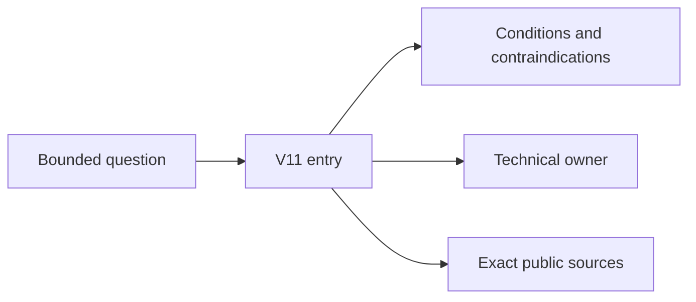

# V11 — System Design pattern atlas

**Status:** Phase 1 scaffold, 2026-10-21. This volume is a navigation and decision layer. It
does not replace technical owners and does not establish technical sufficiency.

## Purpose and mission

The atlas helps a reader move from a bounded problem to a conditional pattern choice. It records
applicability, contraindications, alternatives, failure and recovery questions, candidate
technical owners and exact source routes. The technical chapters remain canonical for mechanism,
guarantees and deep evidence.

Each of the 145 catalog entries has one stable heading in its family chapter. Phase 1 records
the entry inventory and candidate routing only; the full decision cards, source ledgers and
backlinks belong to later phases.

## How to use this volume

1. Start with the chapter that matches the decision family.
2. Read the entry inventory and the candidate area; do not treat a candidate as a confirmed
  owner.
3. Read the technical owner before trusting a mechanism claim.
4. Return to the atlas for alternatives, contraindications and reversal questions.
5. Record missing evidence as missing; do not score it as a pass.

Text alternative: a bounded question leads to one atlas entry, which gives conditions, points to
the technical owner and routes to exact sources. The atlas does not replace the technical owner.

## A worked cross-chapter synthesis

A fictional partner-facing service needs one request to assemble data from three owners, enforce
a per-client quota and keep a degraded but explicit response when one owner is unavailable.

Use the atlas to turn that scenario into bounded questions: which ownership and contract
conditions hold, which alternatives compete, which failure mode is acceptable, and which
technical owner and exact source must be read before deciding.

The worked decision is not a recommendation for a real service. It is a synthetic route that
shows how the atlas, the technical owners and the source ledger must be read together.

## Questions and chapters

- [V11/C01](c01-application-boundaries/README.md) — Application architecture and boundaries (12
  entries).
- [V11/C02](c02-api-communication/README.md) — API and service communication (12 entries).
- [V11/C03](c03-messaging-integration/README.md) — Messaging and event-driven integration (20
  entries).
- [V11/C04](c04-consistency-events/README.md) — Data consistency, transactions and event
  sourcing (14 entries).
- [V11/C05](c05-caching-retrieval/README.md) — Caching and retrieval (14 entries).
- [V11/C06](c06-database-storage/README.md) — Database and storage architecture (13 entries).
- [V11/C07](c07-resilience/README.md) — Resilience and fault tolerance (16 entries).
- [V11/C08](c08-coordination/README.md) — Distributed coordination (9 entries).
- [V11/C09](c09-scalability/README.md) — Scalability and load distribution (10 entries).
- [V11/C10](c10-deployment-modernization/README.md) — Deployment and legacy modernization (12
  entries).
- [V11/C11](c11-security-operations/README.md) — Security, isolation and operational
  architecture (13 entries).

The chapter list is a route, not a fixed page quota. A chapter may need one page or many; the
split follows content and ownership.

## Counterexample and handoff

Naming a pattern does not establish fit: a hot single-writer workload can make a sharded or
event-driven design worse, and a passing link check is not technical evidence.

Handoff: when a decision needs a mechanism guarantee, leave the atlas and read the named
technical owner. If no owner is confirmed, record the gap instead of inventing one.

## Evidence and known limits

- No external source was read for this volume in Phase 1.
- Candidate areas and pages are routing hypotheses, not audited owners.
- Every catalog entry remains not-yet-assessed for both technical and decision coverage.
- The page census and candidate coverage map are inventory evidence, not technical or
  independent review.
- The pattern registry, atlas manifest and coverage map are the current machine-readable
  records.

## Navigation and prerequisites

- Parent: [Tycho book contents](../../README.md).
- First chapter: [V11/C01](c01-application-boundaries/README.md).
- Existing applicability owner: V10/C03 — pattern applicability and contraindications.
- Registry: [pattern registry](../../../edition/patterns/registry.v1.json).
- Coverage map: [candidate coverage](../../../edition/patterns/coverage-map.v1.json).
