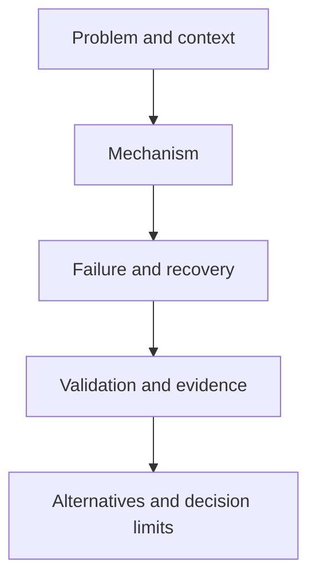

# <Chapter title — reader question>

> Draft chapter landing template. A chapter is not evidence-reviewed because its landing page exists.

## Purpose and mission

Explain the single canonical question this chapter owns, the applicability boundary and the outcomes a reader should be able to verify. State prerequisites and explicit exclusions.

## Read this chapter when…

- <a question or observable failure>
- <an alternative design is under consideration>
- <a workload/consistency/security constraint matters>

## Pages and reasoning route

| Order | Bounded page / section | Question answered | Evidence/readiness | Link |
|---|---|---|---|---|
| 1 | Orientation | Why this mechanism exists and where it fits | proposed | TODO |
| 2 | Architecture and invariants | What happens in normal operation and what must hold | proposed | TODO |
| 3 | Failure, recovery and evidence | Which assumptions fail and how they are checked | proposed | TODO |

Use live links only once the target exists. Some chapters legitimately need one page; others split by coherent question/ownership. Numbers above are *examples*, not mandatory page-count quotas.

## Chapter reasoning map (when the route is nontrivial)

Adapt these **generic placeholders** to actual page relationships. Remove the figure when the chapter is self-explanatory.

Text alternative: establish the bounded problem and mechanism, then examine its failure behavior, supporting evidence and alternative solutions.

## Important distinctions and alternatives

| Commonly confused concept | Canonical explanation owned where | Chapter-specific consequence |
|---|---|---|
| <concept> | TODO | <bounded context> |

## Research state

- **Claim/source verification:** <exact evidence or explicit missing status>
- **Open contradictions:** <do not silently reconcile>
- **Review:** <mechanical / self-reviewed / named independent review event>
- **Next source and writing step:** <bounded work>
