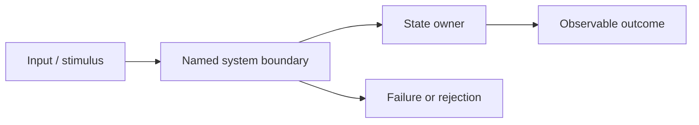

# <One bounded engineering question>

> Document kind: **explanation**. State: draft. Canonical owner: <chapter>. This template intentionally contains no invented source claims, measurements or approval. Future YAML frontmatter and schemas are planned separately.

## Orientation — the problem and its limits

**Question:** <one falsifiable, practical engineering question>

**Context / boundaries:** <users, workload, protocol/state boundary, relevant versions and prerequisites>

**Why it matters:** <observable consequence of a wrong assumption>

**Not in scope:** <link to the canonical owner of adjacent mechanisms or plain TODO>

## Architecture — how it works

### Actors, ownership and flow

Explain components and who owns state; name interactions, requests/events, ordering and consistency assumptions.

1. <step/trigger>
2. <state transition and enforceable invariant>
3. <observable result>

Use a **Mermaid flowchart or sequence diagram** if it improves understanding of this page's architecture, ownership or failure. Replace the following **synthetic illustration** with a precise researched diagram, or omit it when no visual explanation is needed.

Text alternative: an input reaches a named boundary, which interacts with state ownership and leads either to a defined outcome or a failure path. Explain assumptions and cite any *factual* semantics before presenting them as verified; a diagram alone is not evidence.

### Invariants, guarantees and operating envelope

| Invariant or claim | Enforcement boundary | Assumptions, version and workload | Evidence state |
|---|---|---|---|
| <claim> | <actual enforcing mechanism or unknown> | <conditions> | published/observed/inferred/proposed/unknown |

Distinguish "the reference says", "a reproducible experiment shows", "we infer" and "we propose"; none is interchangeable.

### Failure, overload and recovery

| Trigger / condition | User-visible and internal effect | What may be lost, duplicated or delayed | Recovery / test |
|---|---|---|---|
| Normal operation | <...> | <...> | <...> |
| Timeout, retry or partial failure | <...> | <...> | <...> |
| Restart, saturation or dependency loss | <...> | <...> | <...> |

### Trade-offs, alternatives and reversals

What simpler alternative may suffice? Under which **measurable** conditions is this mechanism inappropriate? Which observation would change the recommendation? Avoid universal RPS thresholds, product rankings and unsupported "best practice" claims.

## Evidence — exact scope and verification

| ID | Material claim | Admitted public source and exact section / revision / path | Evidence vs inference | Uncertainty / test needed |
|---|---|---|---|---|
| E-01 | <specific claim> | <public reference; do not cite unread source> | <type> | <...> |

Only cite material actually inspected. Do not mirror non-redistributable sources or invent exact line numbers. If critical evidence is missing, explicitly return **insufficient evidence**.

## Navigation and next steps

- **Prerequisite:** <existing link only>
- **Next question:** <existing link or plain TODO>
- **Related canonical owner:** <avoid copy/paste duplication>
- **Open work:** <small bounded research task>
- **Validation and review:** <actual checks and named review evidence if any>
