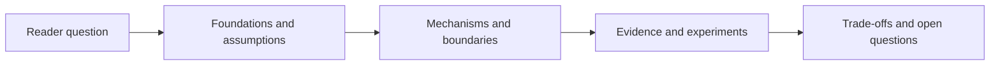

# <Volume title>

> Draft landing-page template. Replace placeholders, remove unused sections; do not mark chapters complete before researched content exists. Future metadata fields and JSON Schema are owned by later issues.

## Purpose and mission

- **Why this volume exists:** <the engineering decisions and failure questions addressed>
- **What the reader will be able to do:** <concrete capability; avoid unsupported promises>
- **What this volume does not cover:** <scope boundary and relevant other volumes>
- **Status and coverage:** <proposed / researching / evidence-reviewed; mention open gaps>

## Map of questions and chapters

| Reader question | Canonical chapter or page | Required prerequisite | Current evidence status |
|---|---|---|---|
| <question> | <relative link or TODO if page does not yet exist> | <chapter/page> | proposed / researched / reviewed |

Do not make dead Markdown links to nonexistent files. Keep TODO as plain text until content is committed.

## Scope and reading map (Mermaid where informative)

Replace the illustrative navigation with relationships genuinely useful to this volume; omit it if it adds no insight. Nodes are template placeholders, **not researched architecture claims**.

Text alternative: start from a reader's question, establish assumptions, understand the mechanism, inspect its evidence and then assess trade-offs or unknowns.

## How to read

- **Start here:** <short orientation page when it exists>
- **When diagnosing a failure:** <recovery or error-boundary chapter>
- **When comparing alternatives:** <document with evidence and alternatives>
- **When validating a claim:** <exact source evidence from a researched page>

## Cross-volume boundaries

| Topic | Canonical owner | Why it is linked rather than repeated |
|---|---|---|
| <topic> | <other volume/page or plain TODO> | <scope-specific consequence> |

## Known limitations and next research

- **Unresolved questions:** <high-consequence missing evidence>
- **Sources to inspect:** <admitted public sources, exact intended sections; not claims of reading>
- **Next bounded writing task:** <issue and desired page>
